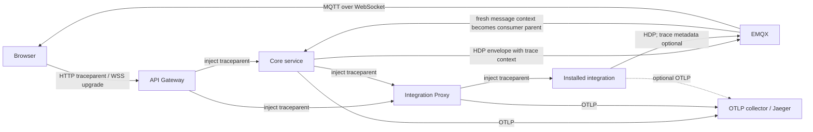

# Advanced Tracing Architecture and Implementation Plan

## Purpose

Provide a single end-to-end trace for a user action that crosses the browser,
gateway, core services, integration proxy, installed integrations, HDP MQTT,
and realtime WebSocket updates. The design supplements request IDs; it does not
replace authentication, audit logs, metrics, or durable command records.

OpenTelemetry instrumentation and export inside installed integrations are
optional. The proxy records its own outbound span even when an integration
emits no spans. In that case the trace ends at the proxy boundary; full
in-integration visibility requires instrumentation. For a fresh, non-retained
command result without trace metadata, device-hub can instead use its matching
pending command's `corr` and stored context to continue the lifecycle trace;
this does not create spans inside the integration. Other integration-originated
messages require compatible propagation for trace continuity.

This document is an implementation plan. It describes the intended contract and
rollout order. The implementation is partial; the status below distinguishes
what exists from what remains planned.

## Implementation status

- Shared HTTP client spans propagate W3C context through gateway REST proxying
  and integration-proxy forwarding and client calls, and automation-service
  outbound clients, auth internal clients, dashboard registry calls, MCP
  gateway calls, and registry discovery/backfill calls. Weather and Google
  OAuth calls create client spans but do not send internal trace headers to
  external providers. Background automation execution preserves the triggering
  span context without retaining the request's cancellation or other values.
  Helm and Compose configure OTLP endpoints for the instrumented services.
  The gateway propagates trace context on upstream
  WebSocket handshakes without altering MQTT messages.
- Integration install, uninstall, update and update-check runtime spans continue the request trace
  while retaining their detached timeout and not carrying request values.
  Restart workers carry only the originating span identity; Helm and Compose
  command spans omit arguments and command output.
- Device-hub and automation commands, device-hub metadata, pairing and lifecycle events, and mock-
  and Zigbee-adapter command results
  optionally carry trace context when `HOMENAVI_MQTT_TRACE_ENABLED=true`.
  Device-hub consumes traced metadata, events, pairing progress, state and command results; registry auto-import and history ingest also consume trace context. Registry realtime events optionally carry the producer span context. The mock adapter consumes
  traced commands, as does the Zigbee adapter for immediate command results.
  Zigbee's asynchronous interview results and state updates do not establish
  command parentage; its state, metadata and event producers start independent
  traces when enabled. Configure root sampling for their expected volume.
  Automation consumes traced state and command-result events
  and carries state context into triggered workflow execution. The current carrier treats messages older than 15 minutes or
  more than one minute in the future as stale, and links retained deliveries.
- Device-hub saves the originating trace context with pending commands and
  restores it for timeout events and fresh, non-retained correlated results
  from uninstrumented adapters. Redis stores the trace separately with at most
  a 15-minute TTL; old or absent metadata does not prevent command handling.
  For direct MQTT commands awaiting a result, automation also caches producer
  context in Redis for at most 15 minutes. A fresh, non-retained result without
  trace metadata can continue that trace only when correlation, device ID and
  result topic match. The cache is best-effort; unavailable or expired context
  does not prevent result handling. Automation records the pending correlation
  before publication so a prompt result can be consumed.
- Opt-in tests export a synthetic MQTT producer/consumer chain and a Zigbee
  command rejection handler trace to Jaeger and check the returned parent IDs.
  The mock-adapter test also sends a command and result through a real broker
  and verifies their parent IDs in Jaeger. Run it with `HOMENAVI_TEST_MQTT_URL`,
  `HOMENAVI_TEST_JAEGER_OTLP`, and `HOMENAVI_TEST_JAEGER_QUERY` set to isolated
  endpoints: `go test ./mock-adapter/internal/adapter -run TestBrokerAndJaegerCommandTrace`.
  The Zigbee test uses a fake MQTT client; neither test verifies a deployed
  browser-to-device flow.
- An opt-in automation test uses isolated Redis and PostgreSQL and can query
  Jaeger to verify a fast, uninstrumented result across automation instances.
  Set `HOMENAVI_TEST_REDIS_ADDR` and `HOMENAVI_TEST_POSTGRES_DSN`, plus the
  Jaeger variables above to check export, then run `go test ./automation-service/internal/engine -run TestUninstrumentedResultAcrossInstances`.
- The Python profile-picture service continues W3C HTTP trace context and can
  export to OTLP. Its spans exclude user IDs, request paths, query values and
  exception details. Browser fetch and XHR instrumentation is enabled by default and
  traces only same-origin API requests; it exports bounded, redacted spans via
  an authenticated and rate-limited gateway endpoint. See the Helm chart notes
  for build-time settings, sampling, and the ingress trust-boundary tradeoff.
- An opt-in long-chain test uses the real gateway router, the real Python
  profile service, two test HTTP services, a real MQTT broker, and Jaeger.
  It asserts ten connected spans, including the exact Python client/server and
  MQTT producer/consumer parent IDs. Set `HOMENAVI_TEST_JAEGER_OTLP` and
  `HOMENAVI_TEST_JAEGER_QUERY` to the isolated collector and query base URLs,
  `HOMENAVI_TEST_MQTT_URL` to the isolated broker, and
  `HOMENAVI_TEST_PROFILE_URL` to a profile service configured to export to the
  same collector; run `go test ./api-gateway/internal/http -run TestLongHTTPMQTTAndPythonTraceInJaeger`.
  `TestBrowserTraceEndpointAuthenticatedAndRateLimited` additionally requires
  `HOMENAVI_TEST_REDIS_ADDR`. These tests do not represent a deployed browser
  command or installed integration.
- Outstanding: optional tracing support in installed integrations, asynchronous
  Zigbee propagation, other deferred command outcomes, remaining MQTT and
  WebSocket event paths, additional integration operation details, deployment-specific sampling,
  ingress rate limits and collector policies, and production end-to-end
  validation. The Python and browser components use their native OpenTelemetry
  SDKs rather than the Go shared library. Do not claim a complete deployed
  browser-to-device trace until the relevant paths are implemented and tested.

## Current state and confirmed gaps

The shared HTTP middleware in `shared/observability` extracts W3C Trace Context
from inbound HTTP headers and starts a server span. It returns a `Trace-ID`
header and can export spans when `OTEL_EXPORTER_OTLP_TRACES_ENDPOINT` is set.
The middleware and instrumented clients do not propagate baggage. The gateway
samples a new local root by default and links both the original incoming context
and its browser-namespaced equivalent. These links are untrusted metadata, not
authentication.
Setting `HOMENAVI_TRACE_INGRESS_NEW_ROOT=false` retains incoming parentage but
allows callers to control sampling and choose trace IDs, so it is only suitable
for trusted ingress. The OpenTelemetry sampler environment settings control
root sampling; ingress rate limiting and collector policy remain deployment work.

The following breaks prevent an end-to-end trace today:

1. Many outbound HTTP clients do not inject the active trace context. Gateway
  integration-proxy, and automation transports are instrumented; other service boundaries
  can still start a new trace.
2. `integration-proxy` has shared middleware and is included in Helm's OTLP
  endpoint allowlist, but deployed versions must include the updated chart and
  application image.
3. Proxy forwarding, marketplace HTTP calls, and Helm/Compose commands have
  spans; other operation stages and background update loops remain incomplete.
4. Shared helpers propagate optional W3C context in HDP payloads, but not every
  producer or consumer uses them yet.
5. Gateway WebSocket handshakes have a client span; message-processing spans
  and complete event correlation are still missing.
6. Background work such as command confirmation, polling, update checks, and
   retries cannot safely retain a request context indefinitely. It needs a
   persisted or explicit parent context at enqueue time.
7. Trace-aware HDP envelopes and device-hub result handlers are implemented;
  other producers and asynchronous results remain incomplete. State is sometimes
  published retained and must not blindly continue an old trace.
8. Several participating runtimes, including entity registry and history,
  need propagation instrumentation and, where absent, tracing initialization.

## Goals

- Preserve a W3C `traceparent` across synchronous HTTP calls.
- Preserve causality across HDP MQTT command, state, and result messages.
- Make WebSocket events traceable to their producer and their originating
  command without exposing trace data to unauthorized clients.
- Emit spans for background work with an explicit enqueue-parent relationship.
- Export every participating core service and `integration-proxy` to the
  configured OTLP endpoint.
- Keep tracing optional, bounded, and safe for production traffic.

## Non-goals

- Do not use trace IDs as authorization, tenancy, device identity, or audit
  record identifiers.
- Do not put credentials, JWTs, PATs, command arguments containing secrets, or
  raw device payloads into span attributes or trace context.
- Do not require MQTT v5 headers. Homenavi must work with the current generic
  and EMQX MQTT configurations.
- Do not create a span for every idle WebSocket ping, retained replay, or
  periodic no-op poll.

## Target architecture



### Trace and correlation identifiers

Use the identifiers for distinct purposes:

| Identifier | Scope | Transport | Purpose |
|---|---|---|---|
| `traceparent` | W3C trace | HTTP header; HDP/event metadata | Parent-child causality and distributed tracing |
| `tracestate` | W3C trace | Same carrier when present | Vendor-specific trace state; preserve but do not interpret in application code |
| `baggage` | W3C baggage | HTTP header only by default | Low-cardinality diagnostic metadata after explicit allowlisting |
| `corr` | Homenavi command lifecycle | HDP command/result/state payload | Stable command/result correlation visible to clients |
| `X-Request-ID` | HTTP request | HTTP header/logs | Human-friendly request-log correlation |
| `event_id` | WebSocket message | Event envelope | De-duplication and support investigation, not tracing |

Never derive `corr` from a trace ID. A single user action may create retries,
fan-out commands, and multiple traces; command correlation must remain stable.

For a sampled, instrumented, fresh command flow, each transport hop creates a
child of the previous hop so all spans share one trace ID. A trace ID alone
does not guarantee exported spans: sampling, retention, exporter failure,
unupgraded participants, and trust boundaries can interrupt visibility. Use
`corr` to find the command lifecycle across those gaps. Correlation must be
propagated explicitly; it is not reconstructed from a trace or inferred from
unrelated device state.

## Propagation contracts

### HTTP

1. Keep `TraceContext` and `Baggage` as the global HTTP propagators, but
  filter incoming and outgoing baggage against an explicit allowlist; default
  to none. MQTT and event carriers use `TraceContext` only.
2. Wrap every outbound `http.RoundTripper` with OpenTelemetry HTTP client
   instrumentation. It must start a client span and inject context into headers.
3. For reverse proxy traffic, inject into the outbound proxy request after route
   authorization and before dialing the integration upstream.
4. At public ingress, treat all trace headers as untrusted. A valid browser
  trace ID may be continued for diagnostics, but use an ingress sampler that
  makes its own bounded sampling decision instead of honoring the remote
  sampled flag; rate-limit trace creation and do not let an attacker choose
  IDs to force sampling. Internal trusted hops use parent-based sampling.
  For deployments that require a new trace at the boundary, start a new root
  and link the inbound context: that intentionally changes the trace ID.
  Neither mode changes tenant identity, user identity, or authorization.
5. Create client spans for marketplace, vendor-cloud, and service-to-service
   calls. Record status and bounded error details, never response bodies.
6. Instrument browser requests and CORS explicitly when browser spans are
  desired; otherwise the first server span is the trace root. Browser WebSocket
  APIs cannot set arbitrary upgrade headers: use the gateway upgrade as the
  connection root and carry context in authorized application messages where
  needed. Never put trace context in URL query strings.

### Integration proxy and runtime operations

`integration-proxy` needs a root HTTP span for install, uninstall, update,
reload, update-policy, manifest refresh, and proxied requests. Each operation
must add child spans for:

- marketplace lookup and artifact resolution;
- configuration read/write;
- Helm or Compose command execution, with command name and exit code only;
- manifest fetch and validation;
- readiness polling and failure classification.

The update loop should create a fresh `integration.update_check` root span for
each timer tick. When an update is queued by an HTTP request, persist a compact
trace context with the operation record and restore it for the worker span. For
scheduled work, use a new root trace with `trigger=scheduled`. Store only valid,
size-limited `traceparent` and `tracestate`, with a short explicit expiry and no
baggage; never retain the request context or its cancellation deadline. Restore
from a fresh worker context, honor worker cancellation, and delete or expire
metadata with the operation. Expired or missing context starts a new trace;
retain the operation/correlation ID for lookup.

### HDP MQTT

The compatibility-safe carrier is a small metadata object in the existing JSON
payload, not a topic change and not an MQTT v5-only property. Proposed shape:

```json
{
  "type": "command",
  "device_id": "lgthinq/device-1",
  "schema": "hdp.v1",
  "ts": 1730000000000,
  "corr": "cmd-...",
  "trace": {
    "traceparent": "00-...-...-01",
    "tracestate": "optional"
  }
}
```

Rules:

1. At the application boundary, create a producer span from the active context,
  inject that span's W3C context into `trace`, then serialize and publish. End
  the span after the publish attempt, recording bounded outcome and QoS. The
  broker is a transport hop, not a tracing participant unless separately
  instrumented. Do not inject into arbitrary non-HDP MQTT payloads or empty
  retained tombstones.
2. For each fresh single-message delivery with valid, trusted context, extract
  it into a fresh processing context and make the producer span the remote
  parent of a consumer span. Pass that context through processing and into any
  resulting producer spans. Thus command -> integration -> result/state ->
  device-hub -> realtime event retains the same trace ID. Use links instead of
  inventing a parent for batches or fan-in from multiple messages; a new root
  plus links deliberately has a different trace ID.
3. Generate one independent `corr` per command and preserve it on every
  causally related result, lifecycle event, and state update when the producer
  can establish that relationship. Retries and redeliveries keep the same
  `corr` but create distinct attempt/processing spans. Fan-out commands have
  distinct command correlations and an optional separate workflow/action ID.
  Unsolicited telemetry must not be assigned a guessed command correlation.
4. Preserve context across device/cloud callbacks, delayed confirmation, and
  process restarts by storing bounded trace context alongside the existing
  command lifecycle entry, keyed and checked by device plus `corr`, with the
  lifecycle's expiry. Do not persist a Go context, credentials, or baggage.
  Restore it into a fresh worker context only for an unambiguous active
  command; clean it up with the lifecycle. If attribution is unknown, context
  is missing/expired, or an older integration drops it, start a new trace and
  preserve `corr` only when genuinely known. Do not claim same-trace continuity
  for that gap.
5. Retained publications can deliver the same payload both live and on replay.
  Allow a fresh causal state publication to include trace context, but never
  treat a delivery with `Retained()` set as a continuation: start a new root
  and optionally link the extracted context. Also apply a configurable maximum
  parent age using the envelope timestamp, with clock-skew bounds, because the
  retain flag alone cannot reliably identify every replay or bridge delivery.
  Expired, absent, malformed, or implausibly future timestamps cannot create a
  parent. Keep replay context bounded; links cross trace IDs and may be absent
  from trace viewers. Do not add duplicate state publications without an
  explicit compatibility and deduplication design.
6. Validate W3C fields and cap the complete metadata size before extraction.
  Drop invalid, oversized, untrusted, or unknown trace metadata without
  rejecting an otherwise valid message; increment a low-cardinality reason
  counter. Apply broker ACLs and tenant checks independently of tracing;
  a valid trace or `corr` grants no authority. Never emit raw payloads,
  credentials, full device-specific topics, or correlation IDs as metric labels.
7. Add optional metadata to both typed `shared/hdp.Envelope` and map-based
  publishers. Preserve unknown fields on actual relay paths without
  assuming ordinary typed JSON decode/re-encode does so. Readers must accept
  missing fields, and writers remain feature-flagged until deployed consumers
  and external integrations are verified tolerant. Preserve topics, payload
  semantics, retain behavior, QoS, and existing MQTT APIs for legacy callers.

#### MQTT coverage and end-to-end flow

Inventory every HDP publisher and subscriber before rollout, including shared
clients and integrations outside this repository. Instrument command,
command-result, state, and event messages end to end; also cover metadata,
adapter hello/status, pairing command/progress, and other HDP MQTT messages
where an existing valid JSON carrier permits an optional field. Give each
meaningful publish and process operation a span when sampled, while propagating
context even when spans are not recorded. Periodic no-op traffic and retained
replay follow the volume and freshness policies above. For non-HDP or
non-object payloads, keep the wire format unchanged until a separately agreed
carrier exists; document those gaps rather than claiming full coverage.

For a normal command, the target parent chain is:

```text
HTTP server -> MQTT command producer -> integration command consumer
  -> MQTT result/state producer -> core result/state consumer
  -> WebSocket event producer
```

Each arrow represents a real parent-child relationship with one trace ID; the
span ID changes at each hop. The command's `corr` accompanies its related HDP
and realtime messages. A later result from an asynchronous vendor callback uses
the saved command context only when that callback can be matched unambiguously.
QoS redelivery may generate another consumer span but must not introduce another
intentional command execution. Specify and test deduplication by command ID at
each executor, including expiry and crash recovery; do not rely on the MQTT
`DUP` flag alone or claim exactly-once device effects when the downstream
device cannot provide them. Preserve existing behavior until that contract is
implemented; tracing itself must not change delivery semantics.

### WebSocket and realtime events

Use the upgraded HTTP request as the connection span parent, but do not leave a
single connection span open indefinitely. Create:

- a short `websocket.connect` span for the upgrade and authentication;
- a span per meaningful inbound command or subscription message;
- a producer span for state, command lifecycle, setup, and error events;
- an event envelope field carrying the active `traceparent` and the existing
  `corr`, when available.

WebSocket event trace metadata is optional for clients. The frontend should
preserve it for diagnostics but must not trust it as a permission signal.
Sampling must exclude high-rate telemetry frames by default.
For a command-derived event, create a producer span from the active message or
restored lifecycle context and inject that span, not the unrelated long-lived
connection context. A browser message that initiates a command may carry an
optional validated application-level trace carrier; never use its context for
authorization. For fan-out, authorize each recipient before sending metadata;
do not leak identifiers between tenants. Event tracing is not a guarantee of
browser-side spans unless the frontend is instrumented and sampled.

## Shared implementation surface

Extend, rather than replace, `shared/observability` with:

| Helper | Responsibility |
|---|---|
| `NewHTTPClient` / transport wrapper | Instruments existing clients while preserving their timeouts, transport options, redirects, and cancellation |
| `InjectHTTPContext` | Injects the configured propagator into an outbound request |
| `ExtractMessageContext` | Validates and extracts bounded trace-only metadata, with replay and freshness handling |
| `InjectMessageContext` | Adds bounded trace-only metadata to an outgoing envelope without changing payload semantics |
| `StartConsumerSpan` | Creates a consumer span with an explicit parent or links and bounded messaging attributes |
| `StartProducerSpan` | Creates producer spans with messaging semantic attributes |
| `SanitizeSpanAttributes` | Applies attribute allowlists and size limits |

The helpers must accept an explicit `context.Context`; avoid global mutable
request state. Keep MQTT and WebSocket helpers in transport-focused packages if
that prevents `shared/observability` from importing protocol clients.
Add context-aware publish and handler entry points without breaking the existing
`mqttx` APIs. Update call sites to pass the active context through processing;
wrapping the existing `Publish(topic, payload)` alone cannot recover it.
Ensure callback contexts have bounded lifetimes and do not reuse HTTP request
cancellation for asynchronous work. Avoid duplicate instrumentation when a
reverse proxy or client transport is already wrapped.

## Deployment architecture

1. Add `integration-proxy` to the Helm OTLP-injection allowlist.
2. Define OTLP endpoint, TLS, headers, and sampling in chart values rather than
   per-service ad hoc environment values.
3. Prefer an OpenTelemetry Collector between applications and Jaeger. The
   collector can batch, tail-sample, redact attributes, and export to a future
   backend without application changes.
4. Keep Jaeger as a backend or development viewer; do not expose it publicly.
5. Add Prometheus metrics for propagation extraction failures, dropped trace
   metadata, MQTT producer/consumer duration, WebSocket event duration, and
   update-operation duration.
6. Define actual head-sampling rates, replay age, maximum carrier/value sizes,
  storage retention, and trace volume budgets before enabling writers. Keep
  command flows eligible for sampling; do not sample individual spans within
  an already sampled fresh trace. Tail sampling requires the collector to see
  all candidate spans and routes for a trace; it cannot recover head-dropped
  spans. Do not use device IDs, `corr`, trace IDs, or full topics as metric
  labels. Restrict collector/Jaeger access and storage permissions.

## Rollout plan

### Phase 0: baseline and guardrails

- Capture a representative command, integration update, and realtime event in
  current logs.
- Define attribute allowlists, maximum value lengths, sampling policy, and
  retention policy.
- Add CI tests proving no secret-bearing configuration is used as a span
  attribute.

### Phase 1: export and synchronous HTTP

- Enable OTLP export for `integration-proxy` in Helm.
- Add outbound client instrumentation to API gateway, core services, and proxy.
- Initialize tracing in each participating service that does not already have it;
  configure browser tracing and public-ingress sampling/baggage policies.
- Instrument reverse proxy forwarding and marketplace fetches.
- Verify Browser -> Gateway -> Proxy -> Integration produces one trace.

### Phase 2: operation and background spans

- Add operation spans for install/update/uninstall and Helm/Compose execution.
- Add explicit roots for timer loops, polling, and retry workers.
- Persist bounded trace context only where a queued operation needs it.
- Verify cancellation, error, and retry spans are visible and bounded.

### Phase 3: HDP MQTT propagation

- Add opt-in envelope metadata helpers and consumer/producer spans.
- Inventory and instrument all compatible HDP MQTT topic families; explicitly
  record non-HDP and legacy carrier gaps before enabling writers.
- Thread explicit contexts through device-hub callbacks and lifecycle storage;
  handle retained messages, expiry, retry attempts, and ambiguous state.
- Update device-hub, entity registry, history, automation, and one integration
  reference implementation.
- Ship readers before required writers, then enable injection by feature flag.
- Verify command -> integration -> state/result is a connected trace.

### Phase 4: WebSocket propagation

- Instrument gateway and integration WebSocket hubs.
- Add trace metadata to meaningful event envelopes behind a compatibility flag.
- Add browser diagnostics that display trace/correlation IDs only in admin
  support tooling.
- Verify command lifecycle updates link to the originating command trace.

### Phase 5: optional integration migration

- Treat integration-proxy as the tracing boundary for the current rollout.
  Installed integrations do not need OpenTelemetry or trace propagation.
- Consider template propagation and integration-specific tests in a later,
  separately scoped rollout. Keep mixed-version compatibility and the MQTT
  propagation flag until that rollout is explicitly approved.

## Test strategy

| Layer | Verification |
|---|---|
| Shared helpers | Unit-test extraction, injection, malformed carriers, redaction, and size limits |
| HTTP | `httptest` downstream server asserts matching trace ID and parent span |
| Proxy | Test authenticated route forwarding retains tracing while preserving auth boundaries |
| MQTT | In-memory and real-broker tests verify parent span IDs and a shared trace ID across command, result, state, and event; cover QoS duplicates, fan-out, reconnect, retained replay/freshness, malformed metadata, unknown fields, tombstones, and mixed versions |
| WebSocket | Test upgrade, command event, state event, reconnect, and sampling behavior |
| Integration update | Test manual and scheduled updates emit operation spans and propagate to marketplace/artifact calls |
| Deployment | Helm render asserts every traced service receives OTLP configuration |
| End-to-end | Query a sampled trace and assert exact trace IDs and parent IDs across HTTP, MQTT producer/consumer, integration, and authorized realtime event; separately verify `corr` survives retries, restarts, missing trace metadata, and unsampled flows |
| Security and load | Exercise untrusted sampled flags, baggage, malformed/oversized carriers, tenant isolation, payload redaction, bounded labels, retention, and configured throughput/sampling budgets |

## Acceptance criteria

- A sampled browser-issued command has correct parent IDs across instrumented
  core services and integration-proxy. When an integration optionally carries
  trace metadata, a fresh unambiguous MQTT chain can include its spans; otherwise
  its internal work is outside the current tracing boundary. EMQX transports the
  message; broker-internal spans are not required. The same `corr` appears on
  causally related command and lifecycle events independently of tracing.
- Retained replay, expired or missing context, legacy integrations, trust-boundary
  resets, and independent telemetry are explicitly allowed to start new traces;
  a known `corr` remains available for lookup without fabricating causality.
- An integration update can be found with one trace ID across the UI action,
  integration proxy, marketplace lookup, runtime command, and readiness check.
- `integration-proxy` exports spans in Helm deployments when an OTLP endpoint is
  configured.
- MQTT and WebSocket tracing adds no required protocol-breaking fields and is
  safe with mixed integration versions.
- No trace contains credentials, complete authorization headers, PATs, or raw
  unbounded device payloads.
- High-volume state traffic remains within documented, measured sampling and
  storage limits. Sampling and exporter loss do not break command execution.

## Risks and mitigations

| Risk | Mitigation |
|---|---|
| Trace volume from state telemetry | Parent-based sampling, topic/event allowlists, and tail sampling in the collector |
| Mixed integration versions | Optional readers first, additive envelope field, feature-flagged writers |
| Secret leakage | Central attribute sanitizer, code review rule, and regression tests |
| Broken parentage on asynchronous work | Explicit enqueue context or span links; never retain contexts indefinitely |
| Broker/client compatibility | JSON envelope metadata, no topic mutation, no MQTT v5 dependency |
| User-supplied trace headers | Treat trace context as untrusted diagnostic data at public ingress |