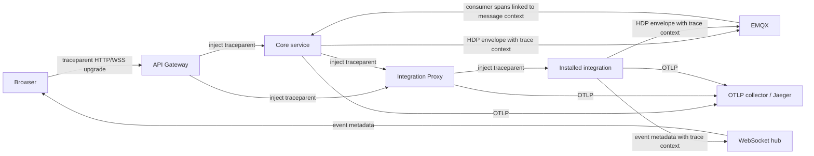

# Advanced Tracing Architecture and Implementation Plan

## Purpose

Provide a single end-to-end trace for a user action that crosses the browser,
gateway, core services, integration proxy, installed integrations, HDP MQTT,
and realtime WebSocket updates. The design supplements request IDs; it does not
replace authentication, audit logs, metrics, or durable command records.

This document is an implementation plan. It describes the intended contract and
rollout order without changing message payloads yet.

## Current state and confirmed gaps

The shared HTTP middleware in `shared/observability` extracts W3C Trace Context
from inbound HTTP headers and starts a server span. It returns a `Trace-ID`
header and can export spans when `OTEL_EXPORTER_OTLP_TRACES_ENDPOINT` is set.

The following breaks prevent an end-to-end trace today:

1. Outbound HTTP clients do not inject the active trace context. A new service
   trace therefore starts at most HTTP boundaries.
2. `integration-proxy` has shared middleware, but the Helm chart does not put
   it in the OTLP environment-injection allowlist. Its local spans are not
   exported in the current cluster deployment.
3. The proxy uses reverse proxying, marketplace fetches, Helm/Compose commands,
   and background update loops without explicit child spans or propagation.
4. The shared MQTT client exposes plain payload publish/subscribe methods. It
   carries neither a W3C context carrier nor an HDP correlation envelope.
5. WebSocket connections preserve HTTP context only through the upgrade. There
   are no connection, receive, send, or message-processing spans, and events do
   not carry correlation metadata.
6. Background work such as command confirmation, polling, update checks, and
   retries cannot safely retain a request context indefinitely. It needs a
   persisted or explicit parent context at enqueue time.

## Goals

- Preserve a W3C `traceparent` across synchronous HTTP calls.
- Preserve causality across HDP MQTT command, state, and result messages.
- Make WebSocket events traceable to their producer and their originating
  command without exposing trace data to unauthorized clients.
- Emit spans for background work with an explicit enqueue-parent relationship.
- Export every participating core service and `integration-proxy` to the
  configured OTLP endpoint.
- Keep tracing optional, bounded, and safe for production traffic.

## Non-goals

- Do not use trace IDs as authorization, tenancy, device identity, or audit
  record identifiers.
- Do not put credentials, JWTs, PATs, command arguments containing secrets, or
  raw device payloads into span attributes or trace context.
- Do not require MQTT v5 headers. Homenavi must work with the current generic
  and EMQX MQTT configurations.
- Do not create a span for every idle WebSocket ping, retained replay, or
  periodic no-op poll.

## Target architecture



### Trace and correlation identifiers

Use the identifiers for distinct purposes:

| Identifier | Scope | Transport | Purpose |
|---|---|---|---|
| `traceparent` | W3C trace | HTTP header; HDP/event metadata | Parent-child causality and distributed tracing |
| `tracestate` | W3C trace | Same carrier when present | Vendor-specific trace state; preserve but do not interpret in application code |
| `baggage` | W3C baggage | HTTP header only by default | Low-cardinality diagnostic metadata after explicit allowlisting |
| `corr` | Homenavi command lifecycle | HDP command/result/state payload | Stable command/result correlation visible to clients |
| `X-Request-ID` | HTTP request | HTTP header/logs | Human-friendly request-log correlation |
| `event_id` | WebSocket message | Event envelope | De-duplication and support investigation, not tracing |

Never derive `corr` from a trace ID. A single user action may create retries,
fan-out commands, and multiple traces; command correlation must remain stable.

## Propagation contracts

### HTTP

1. Keep `TraceContext` and `Baggage` as the global propagators.
2. Wrap every outbound `http.RoundTripper` with OpenTelemetry HTTP client
   instrumentation. It must start a client span and inject context into headers.
3. For reverse proxy traffic, inject into the outbound proxy request after route
   authorization and before dialing the integration upstream.
4. Strip or replace inbound trace headers only at explicit trust boundaries. A
   public browser can supply a trace ID, but it must never control sampling,
   tenant identity, user identity, or authorization.
5. Create client spans for marketplace, vendor-cloud, and service-to-service
   calls. Record status and bounded error details, never response bodies.

### Integration proxy and runtime operations

`integration-proxy` needs a root HTTP span for install, uninstall, update,
reload, update-policy, manifest refresh, and proxied requests. Each operation
must add child spans for:

- marketplace lookup and artifact resolution;
- configuration read/write;
- Helm or Compose command execution, with command name and exit code only;
- manifest fetch and validation;
- readiness polling and failure classification.

The update loop should create a fresh `integration.update_check` root span for
each timer tick. When an update is queued by an HTTP request, persist a compact
trace context with the operation record and restore it for the worker span. For
scheduled work, use a new root trace with `trigger=scheduled`.

### HDP MQTT

The compatibility-safe carrier is a small metadata object in the existing JSON
payload, not a topic change and not an MQTT v5-only property. Proposed shape:

```json
{
  "type": "command",
  "device_id": "lgthinq/device-1",
  "corr": "cmd-...",
  "trace": {
    "traceparent": "00-...-...-01",
    "tracestate": "optional",
    "source": "device-hub"
  }
}
```

Rules:

1. Publishers create a `messaging.publish` producer span and inject the current
   context into `trace`.
2. Consumers extract `trace`, start a `messaging.process` consumer span, and
   publish result/state events with the resulting active context.
3. Retained state must not preserve a live parent context forever. On retained
   replay, create a new consumer span linked to the supplied context rather than
   parenting it directly.
4. Reject malformed trace metadata silently for protocol compatibility; record a
   bounded metric and never reject an otherwise valid device command.
5. Preserve unknown envelope fields when relaying messages to avoid breaking
   integrations upgraded at different times.

### WebSocket and realtime events

Use the upgraded HTTP request as the connection span parent, but do not leave a
single connection span open indefinitely. Create:

- a short `websocket.connect` span for the upgrade and authentication;
- a span per meaningful inbound command or subscription message;
- a producer span for state, command lifecycle, setup, and error events;
- an event envelope field carrying the active `traceparent` and the existing
  `corr`, when available.

WebSocket event trace metadata is optional for clients. The frontend should
preserve it for diagnostics but must not trust it as a permission signal.
Sampling must exclude high-rate telemetry frames by default.

## Shared implementation surface

Extend, rather than replace, `shared/observability` with:

| Helper | Responsibility |
|---|---|
| `NewHTTPClient` | Returns an OTEL-instrumented HTTP client with timeouts unchanged |
| `InjectHTTPContext` | Injects the configured propagator into an outbound request |
| `ExtractMessageContext` | Extracts valid trace metadata from HDP/event envelopes |
| `InjectMessageContext` | Adds bounded trace metadata to an outgoing envelope |
| `StartConsumerSpan` | Creates consumer spans with messaging semantic attributes |
| `StartProducerSpan` | Creates producer spans with messaging semantic attributes |
| `SanitizeSpanAttributes` | Applies attribute allowlists and size limits |

The helpers must accept an explicit `context.Context`; avoid global mutable
request state. Keep MQTT and WebSocket helpers in transport-focused packages if
that prevents `shared/observability` from importing protocol clients.

## Deployment architecture

1. Add `integration-proxy` to the Helm OTLP-injection allowlist.
2. Define OTLP endpoint, TLS, headers, and sampling in chart values rather than
   per-service ad hoc environment values.
3. Prefer an OpenTelemetry Collector between applications and Jaeger. The
   collector can batch, tail-sample, redact attributes, and export to a future
   backend without application changes.
4. Keep Jaeger as a backend or development viewer; do not expose it publicly.
5. Add Prometheus metrics for propagation extraction failures, dropped trace
   metadata, MQTT producer/consumer duration, WebSocket event duration, and
   update-operation duration.

## Rollout plan

### Phase 0: baseline and guardrails

- Capture a representative command, integration update, and realtime event in
  current logs.
- Define attribute allowlists, maximum value lengths, sampling policy, and
  retention policy.
- Add CI tests proving no secret-bearing configuration is used as a span
  attribute.

### Phase 1: export and synchronous HTTP

- Enable OTLP export for `integration-proxy` in Helm.
- Add outbound client instrumentation to API gateway, core services, and proxy.
- Instrument reverse proxy forwarding and marketplace fetches.
- Verify Browser -> Gateway -> Proxy -> Integration produces one trace.

### Phase 2: operation and background spans

- Add operation spans for install/update/uninstall and Helm/Compose execution.
- Add explicit roots for timer loops, polling, and retry workers.
- Persist bounded trace context only where a queued operation needs it.
- Verify cancellation, error, and retry spans are visible and bounded.

### Phase 3: HDP MQTT propagation

- Add opt-in envelope metadata helpers and consumer/producer spans.
- Update device-hub, entity registry, history, automation, and one integration
  reference implementation.
- Ship readers before required writers, then enable injection by feature flag.
- Verify command -> integration -> state/result is a connected trace.

### Phase 4: WebSocket propagation

- Instrument gateway and integration WebSocket hubs.
- Add trace metadata to meaningful event envelopes behind a compatibility flag.
- Add browser diagnostics that display trace/correlation IDs only in admin
  support tooling.
- Verify command lifecycle updates link to the originating command trace.

### Phase 5: enforcement and migration

- Promote transport propagation to the integration template and manifest checks.
- Require propagation tests for integrations that publish HDP commands or state.
- Remove temporary compatibility flags only after all maintained integrations
  accept the metadata envelope.

## Test strategy

| Layer | Verification |
|---|---|
| Shared helpers | Unit-test extraction, injection, malformed carriers, redaction, and size limits |
| HTTP | `httptest` downstream server asserts matching trace ID and parent span |
| Proxy | Test authenticated route forwarding retains tracing while preserving auth boundaries |
| MQTT | In-memory transport verifies command, result, state, retained replay, and malformed metadata behavior |
| WebSocket | Test upgrade, command event, state event, reconnect, and sampling behavior |
| Integration update | Test manual and scheduled updates emit operation spans and propagate to marketplace/artifact calls |
| Deployment | Helm render asserts every traced service receives OTLP configuration |
| End-to-end | Test trace query proves one command forms a connected graph across all participating services |

## Acceptance criteria

- A browser-issued command can be found with one trace ID across gateway,
  device-hub, EMQX producer/consumer processing, the integration, and the
  resulting realtime event.
- An integration update can be found with one trace ID across the UI action,
  integration proxy, marketplace lookup, runtime command, and readiness check.
- `integration-proxy` exports spans in Helm deployments when an OTLP endpoint is
  configured.
- MQTT and WebSocket tracing adds no required protocol-breaking fields and is
  safe with mixed integration versions.
- No trace contains credentials, complete authorization headers, PATs, or raw
  unbounded device payloads.
- High-volume state traffic remains within documented sampling and storage
  limits.

## Risks and mitigations

| Risk | Mitigation |
|---|---|
| Trace volume from state telemetry | Parent-based sampling, topic/event allowlists, and tail sampling in the collector |
| Mixed integration versions | Optional readers first, additive envelope field, feature-flagged writers |
| Secret leakage | Central attribute sanitizer, code review rule, and regression tests |
| Broken parentage on asynchronous work | Explicit enqueue context or span links; never retain contexts indefinitely |
| Broker/client compatibility | JSON envelope metadata, no topic mutation, no MQTT v5 dependency |
| User-supplied trace headers | Treat trace context as untrusted diagnostic data at public ingress |