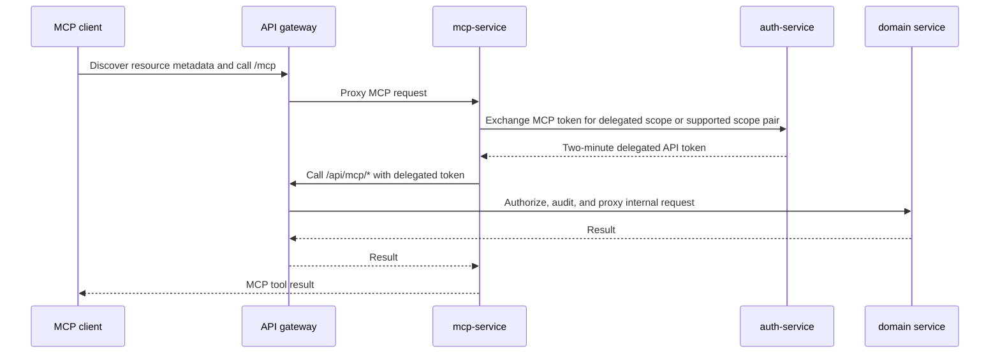

# Homenavi MCP

Homenavi exposes a scoped Streamable HTTP MCP endpoint at `/mcp`. It is a protected OAuth resource; clients discover it from `/.well-known/oauth-protected-resource` and use Authorization Code with PKCE S256.

## Authentication and Consent

MCP access uses dynamically registered public clients with validated HTTPS or loopback redirects. Only resident and admin users can authorize an MCP connection. Access tokens are audience-bound to `/mcp`, signed with RS256, scoped, session-bound, and valid for one hour. OAuth clients receive a rotating refresh token with a 30-day sliding idle timeout and no absolute expiry; it is bound to the client, resource, scopes, consent, and authenticated session. Reuse of a refresh token revokes its session. Browser application sessions use HttpOnly, Secure (on HTTPS), SameSite=Strict access and refresh cookies; browser JavaScript never receives bearer or refresh credentials.

When the browser already has a valid Homenavi web session, the authorization page opens directly at the consent view. A missing or expired web session requires normal Homenavi sign-in and any configured 2FA challenge. Choose at least one of the permissions requested by the client; only the selected scopes are granted and included in its tokens. Consent grants are bound to the client, resource, and selected scopes; they remain valid until explicitly revoked through `DELETE /api/auth/oauth/consents/{clientID}` with the user's API bearer token. Revoking a client immediately prevents its MCP requests, refresh grants, delegated-token exchange, and existing delegated gateway tokens without ending the user's browser session or another client's grant.

### Connection Policy

`POST /api/auth/oauth/register` dynamically registers public MCP clients. Redirect URIs must be HTTPS or loopback HTTP; HTTPS URIs are matched exactly and loopback clients may use an ephemeral port. The authorization-server metadata at `/.well-known/oauth-authorization-server/api/auth` advertises the registration, authorization, token, and JWKS endpoints. Residents and admins use the same tool policy: a tool is available only when its OAuth scope is granted. An admin role does not silently expand the consented scope set. See [Connect an MCP Client](mcp_connection.md) for client setup and redirect requirements.

The OAuth resource is the public `/mcp` URL and is the audience of an MCP access token. When `MCP_RESOURCE_URI` is unset, mcp-service derives that URL from the request's public host and forwarded scheme, including for delegated token exchange. Set `MCP_RESOURCE_URI` explicitly for reverse-proxy production deployments and whenever MCP has a distinct public URL; this avoids proxy-header ambiguity. Set `MCP_AUTHORIZATION_SERVER_ISSUER` explicitly when the public authorization-server origin cannot be reconstructed reliably by the proxy.

## Tool Surface

Tools are advertised only when their OAuth scope is granted and the optional `MCP_ENABLED_TOOLS` allowlist permits them.

| Scope | Tools |
| --- | --- |
| `home.devices.read` | `list_devices`, `get_device`, `get_device_state`, `get_device_states`, `list_device_integrations`, `list_pairings`; with `home.inventory.read`: device inventory also includes entity names, descriptions, rooms, and tags, plus `get_device_group_state` |
| `home.devices.write` | `send_device_command`; with `home.inventory.read`: `send_device_group_command` |
| `home.inventory.read` | `list_rooms`, `list_device_groups`, `get_device_group`; with `home.devices.read`: `search_devices`, `get_room_state`, `get_device_group_state`; with `home.devices.write`: `send_device_group_command` |
| `home.inventory.write` | `create_device_group` |
| `home.history.read` | `query_state_history` |
| `home.automation.read` | `list_automation_workflows`, `get_automation_workflow` |
| `home.automation.execute` | `run_automation_workflow` |
| Any authenticated MCP session | `describe_homenavi_api`, `list_event_channels`, `get_write_policy` |

`get_device_states` accepts 1 to 100 unique canonical `device_ids` and optional `fields` (`online`, `last_seen`, `state`, `state_updated_at`). It returns ordered results with `device_id`, `status`, and selected fields. The default includes online status, state, and the persisted state timestamp. `not_found` and `state_unavailable` are reported per device. The result is the latest state stored by device-hub, not a physical device poll; `read_at` is the response time. An oversized response fails instead of being truncated.

`search_devices` accepts optional `room_id` or exact case-insensitive `room`, a case-insensitive literal `name` substring, exact `device_type` and `capability`, plus `limit` and `cursor`. Filters are combined. `get_room_state` takes the same filters but requires a room. Both require `home.devices.read` and `home.inventory.read`; a room name matching multiple rooms returns candidate IDs instead of choosing one. Default pages contain 25 devices, at most 100. Follow `next_cursor` until absent; a changed inventory invalidates a cursor and requires restarting the search. Unbound devices remain searchable by canonical ID. A device with several bindings appears once for each bound HDP ID; conflicting entities bound to the same HDP device produce an error.

The default search fields are `device_id`, `status`, `name`, `room`, and `type`; room state defaults to `device_id`, `status`, `name`, `type`, `online`, `state`, and `state_updated_at`. Optional `fields` selects from those plus `room_id` and `last_seen`; ID and status are always present. `detail` may be `compact` or `verbose` and cannot be combined with `fields`. `state_properties` limits returned state keys and requires state to be selected. State is read from device-hub when requested, not from the discovery index. A page may be shortened to fit the response budget; a single oversized result fails explicitly.

ERS maintains a shared PostgreSQL projection of device type and capability identifiers. Both non-empty capability `id` and `property` values are normalized to lowercase; no capability is inferred from state. Independent MQTT notifications trigger an authoritative refresh, with a periodic refresh every 20 seconds to recover missed events. The metadata feed rejects a scan if source metadata changes between pages. Searches return a retryable error until a scan succeeds and whenever the last successful scan is more than 60 seconds old. Database migrations must be permitted to install the revision and generation tables and triggers. Monitor reconciliation warnings and ensure device-hub is reachable from ERS.

Write tools are deliberately narrow. Each requires an `idempotency_key` of at least eight characters and is available only to resident or admin MCP tokens. Device commands additionally require an online device and reuse device-hub's persisted correlation lifecycle and capability validation. Group creation and workflow runs persist their idempotency keys and replay the original result on retry. Before invoking a domain tool, mcp-service exchanges the MCP token for a two-minute delegated token with the API-gateway audience and only the required scope or supported scope pair. All MCP device, inventory, history, and automation operations pass through dedicated gateway routes; automation-service additionally validates the delegated token it receives. No separate browser confirmation is required after OAuth consent.

Pairing, automation editing, dashboard changes, user changes, and event subscriptions remain unavailable through MCP.

The original MCP bearer token is never forwarded to internal domain services. Auth-service is the only direct MCP dependency and is used solely for OAuth and token exchange.

## Delegated Gateway Routes

MCP domain operations are not a general external REST API. mcp-service is their only caller and obtains a distinct two-minute token with `typ=homenavi-delegated`, the API-gateway audience, and only the requested scope. The device-read and inventory-read pair is also supported for operations requiring both. The gateway rejects raw MCP tokens, browser API tokens, expired or revoked sessions, non-resident roles, and missing scopes. Every requested delegated scope must already be present on the MCP token.

| MCP capability | Gateway route | Delegated scope |
| --- | --- | --- |
| Device, integration, and pairing reads | `GET /api/mcp/hdp/devices*`, `/integrations`, `/pairings` | `home.devices.read` |
| Batched device states | `POST /api/mcp/hdp/device-states:batch` | `home.devices.read` |
| Filtered search and room state | `POST /api/mcp/ers/discovery:search`, `/discovery:room-state` | `home.devices.read` and `home.inventory.read` |
| Rooms and device-group reads | `GET /api/mcp/ers/rooms/`, `/groups/*` | `home.inventory.read` |
| Device-group state | Device-group read plus device reads | `home.inventory.read` and `home.devices.read` |
| Historical state | `GET /api/mcp/history/state` | `home.history.read` |
| Device command and online-target preflight | `GET /api/mcp/hdp/device-command-targets/*`; `POST|PATCH /api/mcp/hdp/devices/*/commands` | `home.devices.write` |
| Device-group command | Group read plus device command | `home.inventory.read` and `home.devices.write` |
| Group creation | `POST /api/mcp/ers/group-creates` | `home.inventory.write` |
| Workflow reads | `GET /api/mcp/automation/workflows*` | `home.automation.read` |
| Workflow run | `POST /api/mcp/automation/workflows/*/run` | `home.automation.execute` |

For the full trust-boundary diagram and token contract, see [MCP Gateway Delegation Plan](mcp_gateway_delegation_plan.md).

## Connected Applications

User Settings lists each authorized MCP client and its scopes. **Disconnect** calls `DELETE /api/auth/oauth/consents/{clientID}`. Removal immediately invalidates that client's OAuth refresh tokens, MCP access tokens, token exchange, and delegated gateway requests. It does not sign the user out or affect a different connected application. Client secrets and bearer tokens are never displayed.

## Operations

Set `MCP_ENABLED=false` to disable MCP entirely. `MCP_RATE_LIMIT_PER_MINUTE` sets the per-session request ceiling; the production limiter is Redis-backed. With an empty `MCP_RESOURCE_URI`, MCP derives its public resource from the request host and forwarded scheme, but production should configure the canonical public value explicitly. `API_GATEWAY_URL` defaults to `http://api-gateway:8080` and is used for delegated MCP operations. Successful MCP requests emit structured logs with the authenticated subject, client ID, request ID, JSON-RPC method, called tool name when applicable, and response status. Request arguments and returned data are not logged.