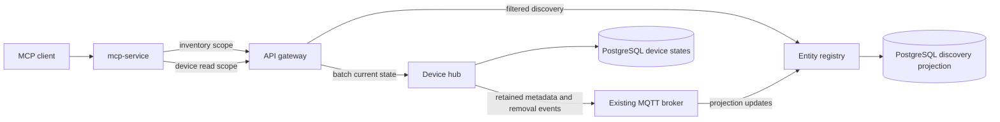

# MCP Device Discovery and Room State Plan

Status: implemented and verified with service, race, isolated PostgreSQL, and MQTT tests. An isolated source-built Compose stack also passed OAuth PKCE, selected-scope, refresh, scope-escalation, MCP connection, filtered search, room-state, and batch-read smoke checks. Batch state, scoped search and room-state tools, an ERS projection, MQTT-triggered and periodic reconciliation, revision-checked metadata paging, and generation-bound discovery cursors are included. Deployment-level target-client compatibility and representative performance measurements remain release gates. See `mcp.md` for the implemented contract.

## Goals and current behavior

Make a room thermostat discoverable with a small, bounded response, without fetching the entire inventory per request. Support room state and multiple known device IDs in one MCP call. Use PostgreSQL and existing infrastructure; do not introduce Elasticsearch, OpenSearch, or another search service.

Today `list_devices` fetches the complete device-hub list, including state, then optionally fetches all entity-registry devices and rooms to add names and room assignments. It requires `home.devices.read`; enrichment additionally requires `home.inventory.read`. The MCP client limits decoding to 256 KiB and silently truncates the decoded list to 100 devices. Device-hub builds its uncached list with one state lookup per device. `get_device` and `get_device_state` each read one device. These limits can both slow discovery and hide a matching device.

ERS owns room and user-facing device records and HDP bindings. Device-hub owns canonical HDP device IDs, type, capabilities, online status, and last reported state. An ERS device can have multiple HDP bindings. HDP metadata is published over MQTT with an optional device type. `/ws/ers` is a local hub and cannot be assumed to provide reliable cross-replica delivery or replay.

## Proposed architecture

1. ERS maintains a small durable projection keyed by canonical HDP ID with device type and normalized capability identifiers. Join it to ERS device, binding and room tables for indexed room/name/type/capability filtering. ERS remains authoritative for names and rooms; device-hub remains authoritative for type, capabilities and state. Unbound HDP devices must remain discoverable as unassigned, and multiple bindings must produce distinct HDP device results without accidental duplication. Define conflict handling for multiple ERS records bound to the same HDP ID instead of picking an arbitrary record.
2. Extend the existing retained HDP metadata envelope with an optional device type and update the producer and consumers compatibly. Build a dedicated, idempotent projection consumer; do not reuse the existing two-minute auto-import suppression for metadata changes. Process metadata, deletion and binding changes, with monotonic versions or another ordering strategy that prevents an old retained message from resurrecting a removed device. Use the existing broker and shared subscription conventions where suitable.
3. Backfill and periodically reconcile the projection against authoritative device-hub metadata, including devices created while the broker or consumer was unavailable. Provide a bounded, paginated metadata-only reconciliation endpoint rather than relying on MCP's truncated list. Design reconciliation so concurrent changes and deletions are not lost. Track projection readiness, generation and last successful reconciliation; while it is unready or too stale for its stated bound, return a retryable error instead of silently reporting an incomplete inventory.
4. Add a device-hub batch read backed by one bounded set-based database lookup for device and latest state rows. Return canonical IDs and per-device results; do not call the existing list endpoint or issue one database query per device. A live read means the latest state persisted by device-hub, not a physical poll of the device. Expose the state's persisted update time separately from device `last_seen`; neither proves the physical device is online or currently reporting.
5. MCP uses a filtered ERS query to resolve IDs and then the device-hub batch endpoint only when state is requested. Reads for already known IDs go straight to device-hub. Project the requested fields before returning results. Discovery remains server-side: filtering an MCP copy of the full registry is not the normal lookup path.

Start with PostgreSQL equality/B-tree indexes for room IDs, normalized names and type, plus a normalized capability relation indexed by capability and HDP ID. Use a bounded case-insensitive substring name search; assess an appropriate PostgreSQL index with `EXPLAIN` and realistic fixture sizes before choosing one. Do not assume a leading-wildcard search benefits from a normal B-tree. Apply parameterized queries, escaped wildcard semantics and input length limits. No external dependencies are required.

## MCP tool contract

Keep the existing no-argument `list_devices` response unchanged during migration. Add new compact tools rather than silently changing the existing contract; publish deprecation and a versioned migration only after client compatibility is measured. All names and limits below are proposed defaults, configurable downward by the operator.

| Tool | Inputs | Default output | Required scopes |
| --- | --- | --- | --- |
| `search_devices` | optional `room_id` or `room`, `name`, `device_type`, `capability`, `fields`, `limit`, `cursor` | `devices` with `device_id`, `name`, `room`, `type`; `next_cursor` when applicable | `home.inventory.read` and `home.devices.read` |
| `get_room_state` | `room_id` or `room`, optional type/capability, `fields`, `limit`, `cursor` | resolved room plus compact devices with `device_id`, `name`, `type`, `online`, `state`, `state_updated_at` | both read scopes |
| `get_device_states` | `device_ids`, optional `fields` | one ordered result per requested ID, with current `online`, `state`, and `state_updated_at` or a per-ID error | `home.devices.read` |

Example: `search_devices({"room":"Bedroom 1","device_type":"thermostat","fields":["device_id","name","room","type"]})` returns only matching compact records. `get_room_state({"room":"Bedroom 1"})` returns the matching room's devices and their last persisted states. `get_device_states({"device_ids":["zigbee/0x001","zigbee/0x002"]})` performs a single batch request.

Use exact case-insensitive room-name matching after trimming; prefer stable `room_id`. If a name matches multiple rooms, return an ambiguity error with bounded candidate IDs and names, never select one silently. Return an empty page for an existing room with no matches; distinguish an unknown room. Name search is case-insensitive substring matching; type and capability use case-insensitive exact normalized IDs. Multiple filters are ANDed. Define and document how capability identifiers derive from device-hub capability `id` and `property`, including missing/legacy metadata; do not infer capabilities from current state keys. Room and device names are data, not authorization boundaries.

Support `detail: "compact" | "verbose"`, default `compact`, and an allowlisted `fields` projection; reject unknown, duplicate, contradictory or unauthorized fields. Keep `device_id` and per-result status mandatory even with projection. Verbose is explicit and bounded, never includes credentials or arbitrary unredacted integration metadata. State fields may contain device-specific properties: support optional allowlisted state-property selection with bounded names/counts, preserving meaningful `false`, `0`, and `null` values. Validate incompatible arguments and limits before upstream calls.

Use default page size 25, maximum 100, a deterministic normalized-name plus canonical-ID ordering, and opaque cursors bound to filter, sort and projection generation. Read generation and page in one consistent database transaction. If a relevant mutation changes the generation, reject the cursor with a restart indication; do not promise a stable snapshot across mutations. Set response byte limits and return a continuation when a page reaches the byte budget; reject a single oversized item with an explicit error. Never silently truncate. Batch maximum: 100 unique IDs; reject duplicates and malformed IDs, preserve input order, and return bounded per-item `not_found`, `unavailable`, or `state_unavailable` results without leaking unauthorized existence. Return a top-level retryable error if the batch service itself is unavailable. Paginate room state and batch each page, with bounded deadlines and cancellation.

## Freshness, cache and security

The PostgreSQL projection is the shared discovery index, not a cache of live state. Short-lived in-process caches are optional: bound size and TTL, coalesce refreshes, and key by deployment, principal/authorization partition, scope set, filter and projection generation. Never cache or reuse bearer tokens. Check token, session, active grant, enabled tools and required scopes on every call, including cache hits. On disconnect/revocation, cached data must not bypass those checks. Set an initial metadata freshness target of 60 seconds under normal operation and monitor reconciliation lag; define behavior for broker partitions and unavailable projections before rollout. Invalidate or version on room rename/delete, device rename/move/delete, binding changes and type/capability changes across all replicas. Do not rely solely on local WebSocket events; reconnect and missed events require reconciliation.

State reads bypass discovery caches and use the persisted state table at request time. Include per-device `state_updated_at`, `last_seen` when requested, and a response `read_at`; expose missing state separately from `{}`. Results are not a cross-device atomic snapshot and may already be old. On timeout, report partial failures explicitly and do not present cached state as live. If a bounded stale-state option is later added, it must be opt-in and carry timestamps and stale indicators.

## OAuth and tool policy

Existing scopes are sufficient: inventory read protects room and user-facing metadata; device read protects device metadata and state. Require both for room search/state rather than leaking room names to device-only grants. Known-ID state batches need device read only. Do not add a new scope merely for a new tool; revisit finer-grained room or capability permissions only as a separate security design with enforcement at every service boundary. Discovery must never imply write, history, automation or subscription access.

The delegated exchange accepts individual scopes and the exact device-read plus inventory-read pair. The discovery routes require both scopes. Domain-service access must remain restricted to authorized gateway traffic, with equivalent service-side checks where that trust boundary requires them. Do not expose the combined projection behind an inventory-only route or rely solely on MCP's tool registration. Keep existing single-scope exchanges compatible and test direct gateway requests with each scope separately, both scopes, revoked grants and forged tokens.

Scope selection is already supported by the consent UI and approval handler; the selected subset is stored in the authorization grant, access token and rotating refresh grant. Existing tests cover UI selection, approval validation and scoped tool discovery; an additional auth test verifies selected-scope delegation succeeds and unselected write delegation fails before and after refresh. A separate tool-allowlist bug was fixed: enabled individual device reads are no longer hidden when `list_devices` is disabled. A real third-party client can still reject a partial grant if it requires all requested permissions; test target clients explicitly.

## API impact

MCP tool input/output JSON schemas and tool descriptions must change for the new tools, independently of OpenAPI. For the recommended efficient design, implement explicit filtered ERS discovery, paginated metadata reconciliation, and device-hub batch-state HTTP contracts; update delegated gateway routes, required scopes, audit tool names, route matching and tests. Document public REST contracts in `doc/openapi.yaml` with schemas, filtering, limits, cursor, partial errors and security. Decide explicitly whether internal `/api/mcp/*` routes belong in public OpenAPI; do not imply that changing only the specification implements them. Keep existing REST list behavior compatible.

No new public WebSocket, subscription tool, or real-time API is required for synchronous lookup and state reads. Existing MQTT metadata and removal traffic can drive the projection, subject to reconciliation and delivery safeguards. The proposed optional HDP metadata `type` field is nevertheless a real-time message-contract change: version/document it in the HDP schema/contract and relevant AsyncAPI or HDP documentation, and test old consumers and missing values. If reconciliation supplies type instead, even that message change may be avoided at the cost of slower type freshness. `/ws/ers` and `/ws/hdp` public channel shapes need not otherwise change. Exposing live MCP subscriptions would be a separate feature and security review.

## Implementation sequence

1. Record baseline response sizes, p50/p95 latency, upstream requests and SQL query counts for representative homes, including more than 100 devices. Capture existing MCP client compatibility and state freshness behavior; establish fixture sizes and hardware before choosing absolute SLOs.
2. Define HDP projection schema, canonical identity/multiple-binding rules, capability normalization, indexes, migration/backfill, generation updates and deletion/reconciliation semantics. Add metadata contract support and idempotent projection ingestion. Test missed, reordered and duplicate events, restarts, broker outages and concurrent updates across replicas.
3. Implement bounded ERS search and deterministic cursor contracts; add device-hub metadata-only pagination and set-based state batch reads. Cover migrations, SQL query plans, caps, partial failures and timestamps. Update gateway route authorization and OpenAPI/contract documentation.
4. Add the three scoped MCP tools, schemas, strict validation, projections, deadlines and size budgets. Keep legacy listing compatible. Update tool allowlists, catalog, user-facing MCP documentation and configuration. Verify unauthorized fields, cache isolation, read-only grants, revocation and no write access.
5. Exercise end-to-end voice assistant flows and target OAuth clients against a representative deployment. Measure payload, p95 latency, query count, error rate and projection lag against the baseline. Initial acceptance targets: at least 75% fewer response bytes than legacy listing for a single-room thermostat lookup, no full-inventory read per warm lookup, and a bounded number of SQL queries independent of total device count for a batch. Report actual results before setting deployment-specific latency SLOs.
6. Roll out schema and producers before consumers and tools, run backfill/reconciliation, confirm projection readiness, then enable tools behind an allowlist/feature flag. Monitor freshness, errors, database load and client adoption. Roll back by disabling new tools and retaining the legacy path; defer removal of additive schema until all consumers are rolled back.

## Verification matrix

- Search: exact/ambiguous/missing rooms, case and wildcard input, type and capability combinations, empty results, unbound devices, multiple bindings, duplicates, malformed fields, cursor invalidation, 100-plus devices and byte limits.
- State: ordered multi-ID reads, empty/duplicate/oversized batches, offline and missing devices, no state, false/zero values, stale timestamps, per-item failures, partial timeout and no N+1 queries.
- Security: each scope alone and together, no write escalation, selected OAuth scopes through authorization/refresh/delegation, revoked grants, per-tool enablement and cross-principal cache isolation.
- Operations: initial backfill, event loss/order/duplication, metadata without type, deletions, restart and multiple replicas, reconciliation lag, degraded dependencies, cancellation, rollback, and legacy client compatibility.