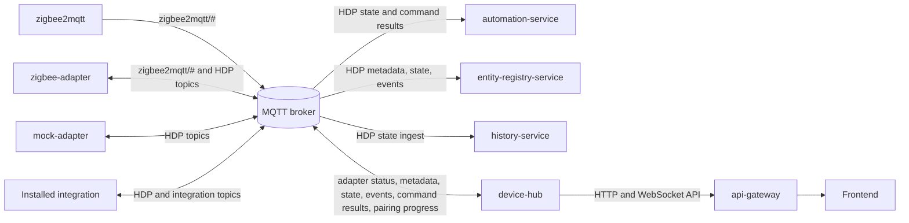
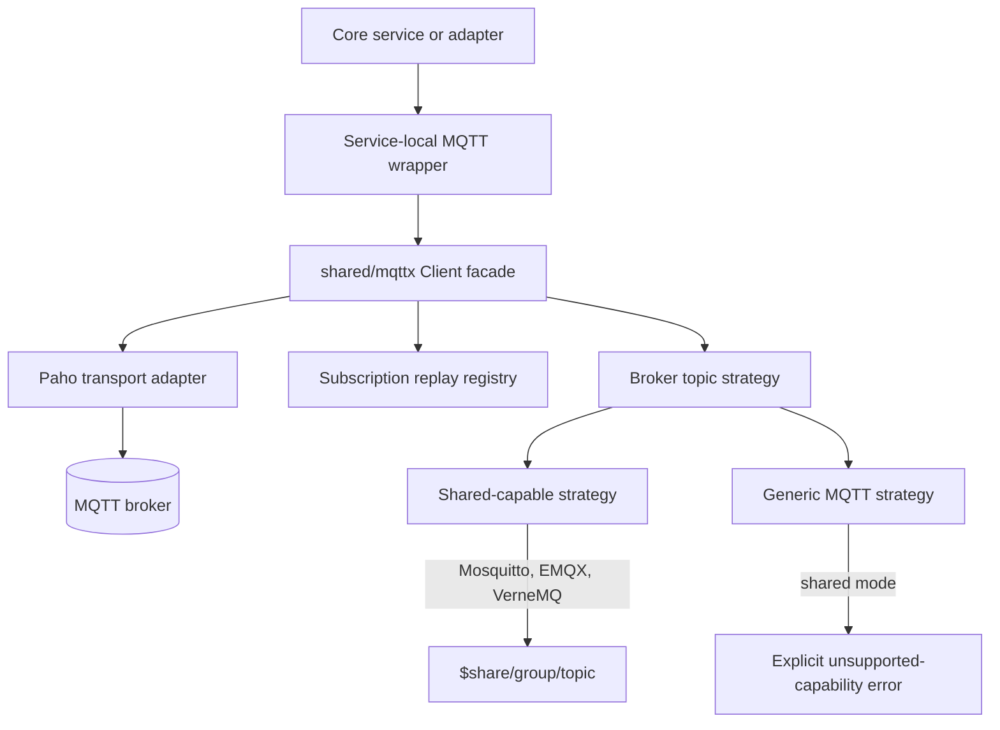
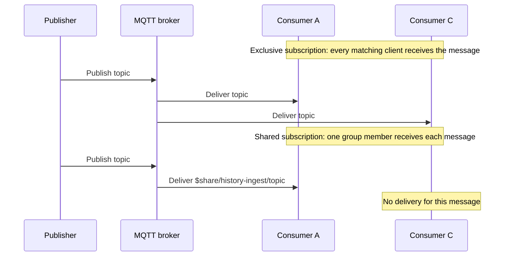
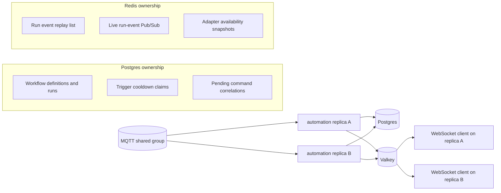
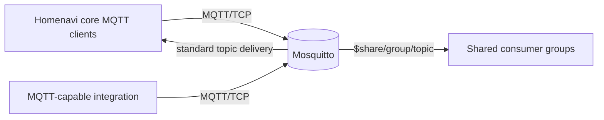

# MQTT Architecture and Broker Compatibility

## Purpose

This document describes the MQTT runtime used by Homenavi: the active broker, clients, HDP topic families, shared-consumer behavior, and supported broker profiles.

Mosquitto is the default broker for Docker Compose and Helm. The Helm HA profile uses VerneMQ; EMQX remains an explicit single-node compatibility profile. Core services use `shared/mqttx`, which keeps service handlers independent from the Paho client library and isolates the MQTT 5 Paho transport in `shared/mqttx/paho_transport.go`.

## Core Topology



The broker carries device-plane messages. Browser clients do not connect to the broker directly; the API gateway exposes the browser-facing WebSocket path and services translate MQTT state into APIs, persistence, and realtime UI updates.

## Client-Layer Design



Responsibilities:
- Service-local wrappers define the narrow message and handler contracts required by the service.
- `shared/mqttx` owns connection lifecycle, subscription intent, broker capability checks, and replay after reconnect.
- The transport adapter owns MQTT 5 Paho-specific APIs, TLS setup, credentials in the broker URL, reconnect handling, and subscription replay.
- Broker strategies resolve typed subscription intent into broker-specific topic syntax.

## HDP Topic Families

All Homenavi Device Protocol messages use the `homenavi/hdp/` root.

| Topic family | Typical publisher | Typical consumers | Purpose |
|---|---|---|---|
| `adapter/hello` | adapters | device-hub | Announces an adapter and supported capabilities. |
| `adapter/status/<adapter>` | adapters | device-hub | Retained adapter health and availability. |
| `device/metadata/<device>` | adapters/device-hub | device-hub, ERS | Device identity and capabilities. |
| `device/state/<device>` | adapters/device-hub | device-hub, history, automation, ERS | Device state, often retained. |
| `device/event/<device>` | adapters/device-hub | device-hub, ERS | Lifecycle and non-state events. |
| `device/command/<device>` | device-hub/automation | adapters | Command requests. |
| `device/command_result/<device>` | adapters/device-hub | device-hub, automation | Correlated command outcome. |
| `pairing/command/<protocol>` | device-hub | adapters | Start, stop, or configure pairing. |
| `pairing/progress/<protocol>` | adapters/device-hub | device-hub | Pairing lifecycle updates. |

## Delivery Modes



Current decisions:
- `history-service` can use `HISTORY_SERVICE_MQTT_SHARED_GROUP` for shared state ingestion.
- `entity-registry-service` can use `ENTITY_REGISTRY_MQTT_SHARED_GROUP` for shared metadata, state, and event auto-import.
- `automation-service` can use `AUTOMATION_SERVICE_MQTT_SHARED_GROUP`: Postgres claims trigger cooldowns and pending command correlations, while Redis shares run-event replay and live fan-out.
- `device-hub` can use `DEVICE_HUB_MQTT_SHARED_GROUP`: adapter availability is Redis-backed, device state is durable, and pairing transitions use Postgres protocol transactions.
- Zigbee and mock adapters remain exclusive singleton adapters.

## Stateless Service Direction



Automation shared mode is enabled when `AUTOMATION_SERVICE_MQTT_SHARED_GROUP` is configured with Mosquitto, EMQX, or VerneMQ. Postgres provides durable claims and recovery state; Valkey provides a bounded replay list that WebSocket replicas poll for cross-replica event delivery.

Device-hub can use the same shared-consumer model when `DEVICE_HUB_MQTT_SHARED_GROUP` is configured with Mosquitto, EMQX, or VerneMQ. Postgres owns pairing transitions and lifecycle history; Valkey provides adapter availability and active command coordination. See [doc/mqtt-ha-shared-subscriptions-plan.md](mqtt-ha-shared-subscriptions-plan.md).

## Docker Compose

Compose starts Mosquitto and injects these settings into core MQTT consumers:

```dotenv
MQTT_BROKER_URL=mqtt://mqtt-broker:1883
MQTT_BROKER_KIND=mosquitto
HISTORY_SERVICE_MQTT_SHARED_GROUP=
ENTITY_REGISTRY_MQTT_SHARED_GROUP=
AUTOMATION_SERVICE_MQTT_SHARED_GROUP=
DEVICE_HUB_MQTT_SHARED_GROUP=
```

To point the core services at another standard MQTT broker, set both values consistently. `MQTT_BROKER_KIND` controls broker capabilities; it is not inferred from the URL.

## Helm

Helm exposes the selected bundled provider through the stable `mqtt-broker` Service. It injects `MQTT_BROKER_URL` and `MQTT_BROKER_KIND` into core services marked `usesMQTT`; the HA profile selects VerneMQ behind the same endpoint.

```yaml
dependencies:
  mqtt:
    provider: mosquitto

mqtt:
  brokerUrl: ""
    brokerKind: mosquitto

services:
    automation-service:
        env:
            AUTOMATION_SERVICE_MQTT_SHARED_GROUP: ""
```

For an externally managed broker, set `mqtt.brokerUrl` to the reachable endpoint, set `mqtt.dependencyHost` and `mqtt.dependencyPort` for startup checks, and choose `mqtt.brokerKind: mosquitto`, `emqx`, `vernemq`, or `generic` according to the broker's shared-subscription support.

Integration-proxy Helm installs pass `MQTT_BROKER_URL` to integration charts as `mqtt://mqtt-broker.<namespace>.svc.cluster.local:1883`. Marketplace integrations use exclusive subscriptions and do not receive broker kind; the integration template retains typed topic-resolution helpers for integrations that deliberately implement shared consumers.

## Enabling Shared Consumers

Shared mode is opt-in. Set a non-empty group only when using Mosquitto, EMQX, or VerneMQ and when the service is deployed with Valkey/Postgres dependencies available.

```dotenv
MQTT_BROKER_KIND=mosquitto
HISTORY_SERVICE_MQTT_SHARED_GROUP=history-ingest
ENTITY_REGISTRY_MQTT_SHARED_GROUP=entity-registry-autoimport
AUTOMATION_SERVICE_MQTT_SHARED_GROUP=automation-events
DEVICE_HUB_MQTT_SHARED_GROUP=device-hub-ingest
```

Do not set these group variables with `MQTT_BROKER_KIND=generic`. Startup validation rejects that incompatible combination.

## Broker profiles

Core Homenavi services negotiate MQTT 5 through `shared/mqttx`. Mosquitto is the default single-node MQTT 5 profile and supports the standard `$share/<group>/<topic>` form used by Homenavi. VerneMQ uses the same topic form for the clustered Helm HA profile. EMQX is available through the explicit Compose overlay or Helm provider, but its BSL 1.1 terms require separate review for use outside the single-node compatibility profile. Integrations that maintain their own direct MQTT client are independently versioned and must be migrated separately.



Use the generic broker configuration only when the target broker does not support shared subscriptions:

```dotenv
MQTT_BROKER_URL=mqtt://external-broker:1883
MQTT_BROKER_KIND=generic
```

With `MQTT_BROKER_KIND=generic`:
- all exclusive subscriptions continue to work
- `history-service` and `entity-registry-service` must leave their shared-group variables unset
- their startup configuration rejects a non-empty shared-group value with `MQTT_BROKER_KIND=generic`
- attempts to request `SubscriptionModeShared` fail explicitly instead of publishing an unsupported `$share/...` topic

For bridge direction and command-ownership rules, see [doc/mqtt_broker_topologies.md](mqtt_broker_topologies.md).

## Browser WebSockets

Mosquitto provides MQTT-over-WebSocket on port `9001` in Compose. The frontend does not use that listener directly; API Gateway handles browser-facing websocket routing.

When using Mosquitto, enable a WebSocket listener only if another component explicitly requires native MQTT-over-WebSocket. It is not a replacement for the API Gateway WebSocket API.

## Integration Author Guidance

Integrations should:
- use `MQTT_BROKER_URL` supplied by the runtime
- keep subscriptions exclusive
- avoid broker-specific hostnames and broker-kind configuration
- publish HDP messages under the documented topic families

The integration template's `mqttsupport.ResolveSubscriptionTopic` demonstrates the same exclusive/shared resolution model without forcing a specific MQTT client library.