# HomeNavi Orion Voice Control: Architecture and Implementation Roadmap

Status: Proposed implementation plan
Date: 2026-10-15
Owners: Core Platform, Edge Runtime, AI Integration
Scope: A cluster-first proof of concept that grows into a production-minded BYOD voice-control platform

## 1. Decision Summary

Orion is a voice interaction layer for HomeNavi. A room satellite captures an utterance after local wake-word detection, sends only the active utterance to HomeNavi, receives a spoken response, and can stop local playback immediately when interrupted.

The initial product shape is deliberately small:

- Add one optional core service named `voice-gateway` to this repository.
- Keep the satellite runtime in a separate repository named `homenavi-orion-satellite`.
- Define a versioned satellite protocol and test fixtures in this repository.
- Publish a reference BYOD satellite agent and compatibility documentation; HomeNavi does not sell, attest, or require a specific hardware appliance.
- Register each satellite as a first-class HomeNavi device through Device Hub and expose its room, state, and capabilities through HDP and ERS.
- Connect Open WebUI directly to the existing HomeNavi MCP server so the LLM runtime executes MCP tool calls and produces the final text response.
- Keep `voice-gateway` provider-agnostic through STT, TTS, and LLM-runtime adapter contracts; use Open WebUI only as the first LLM-runtime adapter.
- Start with cluster-hosted final-utterance STT and sentence-level TTS in half-duplex mode.
- Enable barge-in only after real hardware validation of AEC, VAD, and cancellation.

The first delivery target is one Raspberry Pi with the existing ReSpeaker and Creative Pebble V3 speakers, connected to the existing cluster-hosted Open WebUI `orion` model. That model already has HomeNavi MCP access and uses `gpt5.6-luna`; the POC validates the missing audio/session path rather than rebuilding the model or MCP integration.

This avoids two failure modes: embedding Linux audio/hardware concerns in the core repository, and prematurely creating separate STT, TTS, orchestration, and model microservices before one complete turn is measured on real hardware.

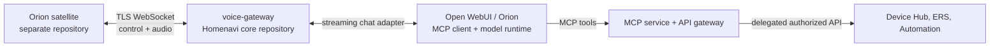

## 2. Goals and Explicit Non-Goals

### Goals

1. Wake-word detection and mute behavior remain local to a room satellite.
2. Idle microphone audio is never sent to HomeNavi.
3. Each utterance has a server-owned session, turn, and playback lifecycle.
4. A model can use HomeNavi capabilities without becoming an authorization boundary.
5. TTS output is sent only to the satellite that initiated the turn.
6. A satellite can stop its own speaker without waiting for a backend response.
7. Two rooms can run independent turns without cross-routing or cancellation leakage.
8. Voice is an optional HomeNavi profile: core device control remains usable without model, STT, TTS, or satellite workloads.

### Non-Goals for v1

- Speaker biometrics or passive user identification.
- Perfect full-duplex audio in every acoustic environment.
- General multi-room media distribution.
- Offline general-purpose LLM inference on a Pi.
- A universal ESP32 satellite implementation.
- Storing raw audio by default.
- Replacing the Open WebUI browser experience.
- A new, independent authorization system for voice actions.

## 3. Repository and Release Boundaries

### 3.1 Core Repository: `homenavi`

This repository owns the shared home control plane and should contain:

```text
homenavi/
  voice-gateway/
    cmd/voice-gateway/
    internal/
      app/
      auth/
      protocol/
      sessions/
      turns/
      providers/
        llm/
        stt/
        tts/
      deviceadapter/
      observability/
  shared/voiceproto/
  doc/orion/
  helm/homenavi/
```

Responsibilities:

- Orion HDP adapter pairing, credential verification, revocation, and session lookup;
- HDP adapter metadata/state/capability publication for paired satellites;
- WebSocket session endpoint and protocol validation;
- turn state machine, deadlines, cancellation, bounded queues, and recovery;
- STT, TTS, and LLM-runtime adapter interfaces with provider capabilities;
- a first Open WebUI LLM-runtime adapter;
- persistent session and conversation mapping;
- metrics, traces, audit events, and deployment profiles;
- protocol JSON schemas, reference fixtures, and conformance tests.

`voice-gateway` is a first-class core service, not an installed marketplace integration. It needs access to HomeNavi identity, HDP/Device Hub, ERS room resolution, and observability. It should enter the service map beside `mcp-service` and `automation-service`.

The Orion HDP adapter may initially be hosted inside `voice-gateway` or deployed as a dedicated `orion-adapter` service. This is an implementation/deployment decision, not a different product flow: either form registers protocol `orion` with Device Hub, responds to the central pairing command, and publishes the same HDP metadata, state, events, command results, and pairing progress. The POC may co-locate it in `voice-gateway`; split it only when independent lifecycle, availability, or scaling makes that worthwhile.

### 3.2 Edge Repository: `homenavi-orion-satellite`

The satellite needs a separate release cadence and hardware-focused dependencies. It is a reference BYOD implementation, not a locked appliance image: users can run it on supported hardware, adapt it to their own Linux device, or implement the public protocol independently. It should contain:

```text
homenavi-orion-satellite/
  cmd/orion-satellite/
  internal/
    audio/
    wakeword/
    vad/
    playback/
    protocol/
    state/
    diagnostics/
  packaging/
    systemd/
    container/
  config/
  docs/
  tests/
```

Responsibilities:

- stable ALSA/PipeWire device discovery and diagnostics;
- ReSpeaker channel selection, VAD, wake-word, and local mute;
- capture, local endpointing, and audio frame transport;
- playback queue and immediate local stop;
- reconnect behavior, LED/display status, and local logs;
- device credential storage and provisioning client;
- hardware-in-the-loop test utilities.

The reference documentation must distinguish supported reference hardware from compatible BYOD hardware. It should provide setup, audio diagnostics, configuration, pairing, protocol compatibility, HDP capability mapping, troubleshooting, and conformance-test guidance; it must not promise support for every microphone, speaker, or operating system.

The satellite must not import Go packages from HomeNavi core. Its only compatibility contract is the published voice protocol. This keeps the future ESP32 implementation feasible without forcing the core service to understand edge audio libraries.

### 3.3 Contract Ownership

The protocol is owned in `homenavi/shared/voiceproto` and published as a versioned artifact. Both repositories consume the same schemas and fixtures.

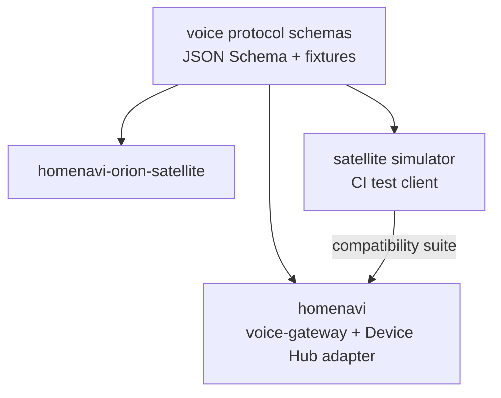

Protocol compatibility policy:

- Every frame carries `protocol_version`.
- Additive fields are allowed in a minor version.
- Message-type removals or semantic changes require a major version.
- The gateway accepts the current and one previous minor version during rollout.
- The satellite refuses to send audio until `session.accepted` confirms a compatible version and negotiated audio format.

## 4. Target Architecture

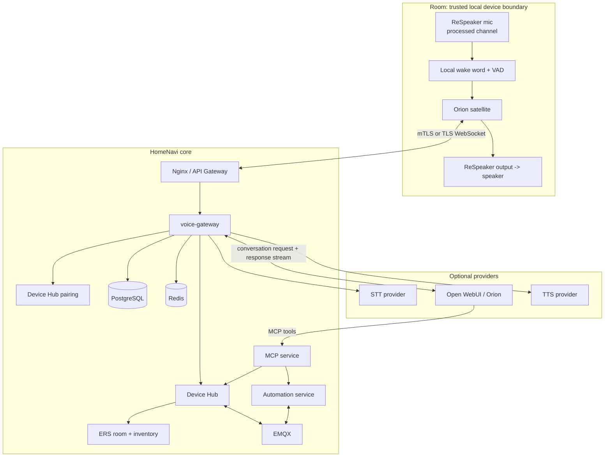

### 4.1 Why `voice-gateway` Is One Service Initially

The gateway coordinates the latency-critical turn. Splitting it into STT broker, LLM broker, TTS broker, and session service would add network hops, distributed cancellation races, and more deployment work before the measured bottleneck is known.

Use provider-agnostic internal interfaces instead. The `LLMRuntime` owns the model conversation and MCP tool loop; the gateway provides trusted device/room context and receives only normalized response events.

```text
DeviceAuthenticator
  AuthenticateSatellite(credential) -> DevicePrincipal

SpeechToTextProvider
  Capabilities() -> SpeechToTextCapabilities
  Transcribe(ctx, request) -> Transcript

LLMRuntimeProvider
  Capabilities() -> LLMRuntimeCapabilities
  StartTurn(ctx, request) -> ResponseEventStream
  CancelTurn(ctx, runtimeTurnID) -> error

TextToSpeechProvider
  Capabilities() -> TextToSpeechCapabilities
  Synthesize(ctx, request) -> AudioSegmentStream

SatelliteDeviceAdapter
  RegisterOrUpdate(ctx, satellite) -> HomeNaviDevice
  PublishState(ctx, deviceID, state) -> error
  HandleCommand(ctx, deviceID, command) -> CommandResult
```

The contracts use provider-neutral request and response types: language, input/output audio format, deadlines, cancellation, response segments, stable errors, and optional capability flags. A caller must branch only on declared capabilities such as streaming input, streaming output, tool-use support, cancellation support, and supported voices/languages, never on an Open WebUI/STT/TTS brand.

The first implementations are `OpenWebUIRuntime`, one selected `SpeechToTextProvider`, and one selected `TextToSpeechProvider`. Later implementations can target a direct LLM API, local runtime, hosted STT, or local TTS without changing turn/session code or the satellite protocol.

Split a provider into a separate service only when one of these conditions is measured:

- a GPU/accelerator scheduling boundary is required;
- an STT or TTS engine requires isolated process lifecycle or native dependencies;
- concurrency scaling differs materially from gateway session scaling;
- privacy policy requires a local-only provider deployment;
- a provider outage must not consume gateway worker capacity.

## 5. Trust, Authorization, and Privacy

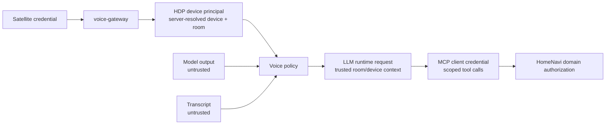

Rules:

1. A satellite does not choose `user_id`, `owner_id`, or an authoritative `room_id`.
2. The gateway resolves device identity from its Device Hub/HDP registration and derives room context through ERS.
3. Open WebUI is the MCP client: it chooses and executes MCP tools as part of the model turn, then generates the final text response.
4. Open WebUI authenticates to MCP through the same OAuth 2.1 Authorization Code with PKCE flow as every other MCP client. The consented HomeNavi user and scopes are the authorization principal; satellites never receive MCP credentials.
5. Every voice satellite may address every room and device permitted by that user's consented MCP scopes. The trusted originating device/room is context and audit data, not a default target-room restriction.
6. High-impact commands require a policy decision such as confirmation, explicit utterance wording, or a companion-app approval.
7. Raw audio is transient by default. Logs contain IDs, durations, provider status, and safe error codes, not audio, PATs, OAuth tokens, or full transcripts.
8. Diagnostics that capture audio must be opt-in, time-bounded, encrypted at rest, and removable.

### 5.1 Central Device Pairing and Discovery Lifecycle

Orion uses the existing central **Devices** tab pairing flow, not a voice-specific admin UI. The Orion HDP adapter advertises its pairing schema/configuration to Device Hub and handles the standard `pairing_command` / `pairing_progress` lifecycle. The adapter may run in `voice-gateway` or in a dedicated service, but the Devices UI sees one protocol adapter named `orion`.

Pairing discovers and authenticates the satellite; it does not name it or assign it to a room. After the adapter publishes retained HDP metadata/state for the discovered `orion/<external_id>`, Device Hub exposes it and ERS creates or binds the canonical inventory record using the normal reconciliation flow. The user later assigns room placement from the map view, which is intentional and remains the sole room-placement workflow.

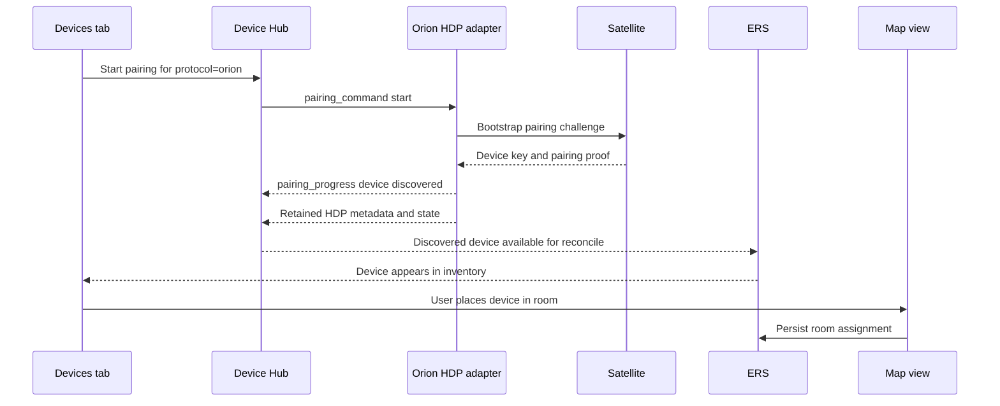

The adapter emits structured logs for pairing start, progress, timeout, success, and failure with `adapter_id`, `pairing_session_id`, `device_id` when known, and a safe error code. It must not log pairing codes, certificates, tokens, private keys, or raw audio.

### 5.2 Origin Context and Household-Wide Control

The gateway always knows which assistant started a turn because it authenticated the satellite session. It records the server-derived `origin_device_id`, `origin_room_id`, `session_id`, and `turn_id`, then sends that trusted context with the transcript to the LLM runtime. This context is useful for interpreting relative language such as "here", selecting the replying speaker, tracing a failure, and future per-room policy. It does not limit the target of a v1 request.

| Context | Source | Use | May limit target rooms? |
|---|---|---|---|
| Origin device and room | authenticated satellite + ERS | "here" resolution, response routing, audit | No |
| Target device/room | explicit user request or model resolution | command target | Yes, must be within household policy |
| OAuth-consented MCP user | HomeNavi OAuth consent | MCP authorization | Yes, limited to granted scopes and household access |

For example, a kitchen satellite may execute "turn off the bedroom lights" when the household voice policy permits it. "Turn off the lights here" resolves to the kitchen only because the gateway supplied the trusted origin room in the LLM request.

The MCP server does not infer a room from the network connection. It receives an explicit target in every device-affecting call. The gateway supplies trusted origin context only to the LLM runtime. Open WebUI independently selects its configured HomeNavi MCP tool, resolves language into an explicit target, and invokes the MCP endpoint. MCP validates that target against the household principal.

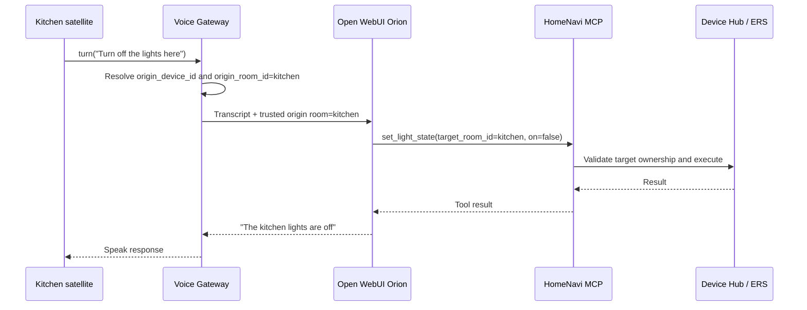

### 5.3 Voice Target Resolution Contract

All device-affecting MCP tools used by voice require a target selector. The selector is one of `target_device_id`, `target_entity_id`, `target_room_id`, or a documented group/tag identifier. A tool never silently defaults to the room of the MCP connection.

| Spoken request | Trusted origin supplied to Orion | MCP target argument |
|---|---|---|
| "Turn off the lights here" | `origin_room_id=kitchen` | `target_room_id=kitchen` |
| "Turn off the bedroom lights" | `origin_room_id=kitchen` | `target_room_id=bedroom` |
| "Turn off the desk lamp" | `origin_room_id=kitchen` | `target_device_id=desk_lamp` |
| "What is the temperature here?" | `origin_room_id=kitchen` | `target_room_id=kitchen` |

For an ambiguous request such as "turn off the lights", v1 policy is explicit: resolve it to the origin room, ask a clarification question, or reject it. It must never pick an arbitrary room. The Open WebUI system instruction and MCP tool descriptions must require this behavior. MCP remains authoritative: it resolves the supplied target ID and rejects any target outside the OAuth-consented user's household access and granted scopes.

## 6. Session and Turn Model

The gateway owns canonical server-side state. The satellite owns only immediate local capture/playback state.

| Identifier | Created by | Purpose | Persistence |
|---|---|---|---|
| `device_id` | Device Hub | Stable HomeNavi identity created after pairing | Device Hub / ERS |
| `room_id` | gateway/ERS | Current logical location | ERS reference |
| `session_id` | gateway | One connected satellite session | Redis + memory |
| `conversation_id` | gateway | Conversation-history scope | PostgreSQL |
| `turn_id` | gateway | One utterance and response lifecycle | PostgreSQL/Redis |
| `playback_id` | gateway | One outbound response playback | Redis + edge memory |
| `request_id` | gateway | Trace/correlation across services | logs/traces |

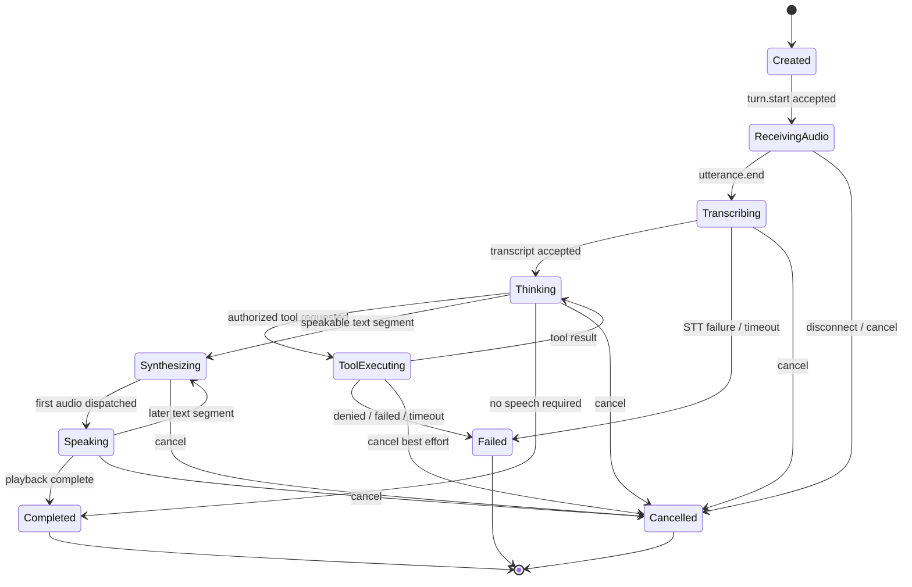

Terminal states are immutable. Every asynchronous callback checks the active turn and playback IDs before publishing output. A cancellation stops future output; it does not roll back a completed device command.

## 7. Protocol Definition

Use TLS WebSocket for the prototype:

- text frames: JSON control envelope;
- binary frames: documented audio framing;
- server and satellite: ping/pong plus application heartbeat;
- ingress: a dedicated `/voice/v1/sessions` route to `voice-gateway`;
- maximum message and frame limits are enforced before decoding.

### 7.1 Control Envelope

```json
{
  "protocol_version": "1.0",
  "type": "turn.start",
  "event_id": "evt_...",
  "session_id": "ses_...",
  "turn_id": "turn_...",
  "sent_at": "2026-10-15T12:00:00Z",
  "payload": {}
}
```

Initial control message types:

| Direction | Event | Meaning |
|---|---|---|
| Edge -> gateway | `session.open` | Authenticate and negotiate format |
| Gateway -> edge | `session.accepted` | Session, device policy, audio format accepted |
| Edge -> gateway | `turn.start` | A local wake word created an utterance |
| Edge -> gateway | `audio.start` | Declares following input audio stream |
| Edge -> gateway | `utterance.end` | VAD endpointing completed |
| Gateway -> edge | `turn.state` | Safe progress state for diagnostics/UI |
| Gateway -> edge | `playback.start` | Declares output audio stream |
| Gateway -> edge | `playback.complete` | No further chunks for playback |
| Either | `turn.cancel` | Cancel a specific active turn |
| Gateway -> edge | `turn.error` | Stable safe error code + user message |
| Either | `heartbeat` | Liveness and clock diagnostics |

### 7.2 Binary Audio Frame Header

Do not base64-encode continuous audio into control JSON. Define a fixed binary header with these fields:

```text
protocol_version | direction | session_id | turn_id | playback_id | sequence
codec | sample_rate_hz | channels | sample_format | payload_length | payload
```

Initial profile:

- mono PCM signed 16-bit little endian;
- one negotiated sample rate per session, initially 16 kHz input and 24/48 kHz output as supported;
- 20-40 ms input frames;
- strict frame-size maximum;
- bounded out-of-order tolerance for output only;
- no retransmit requirement for initial LAN prototype.

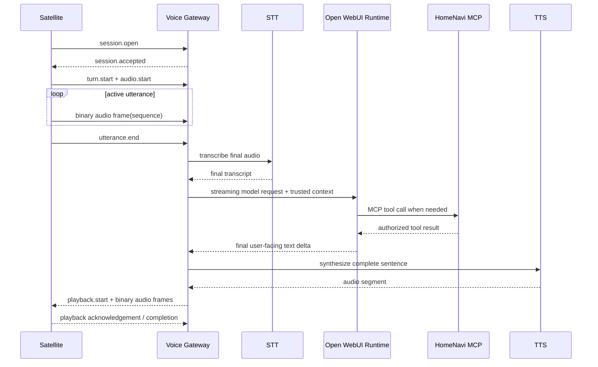

## 8. Provider Architecture

### 8.1 Open WebUI Adapter

The first LLM-runtime adapter calls the installed Open WebUI Orion configuration through its supported streaming chat API. Open WebUI is configured as the HomeNavi MCP client, executes tool calls itself, incorporates tool results into the model conversation, and returns the final response stream to `voice-gateway`. The gateway must parse that stream as structured events, never as plain text.

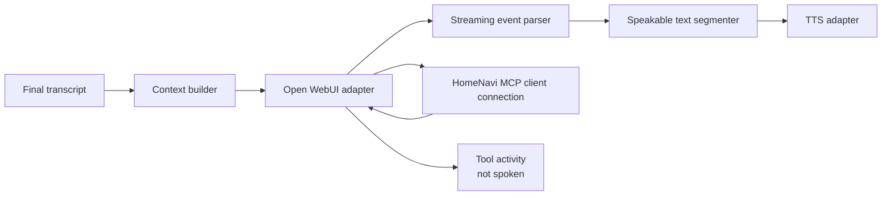

The adapter responsibilities are:

- map HomeNavi turn/cancellation and trusted HDP/ERS context to provider request context;
- map configured conversation identity without leaking across rooms;
- classify text, usage, terminal errors, and tool activity only when the Open WebUI response stream exposes it;
- send only model user-facing prose to the sentence segmenter;
- stop consuming/cancel the upstream request where provider support exists;
- record model timing without logging raw provider payloads.

### 8.2 MCP Credential and Context Constraint

Open WebUI connects directly to HomeNavi MCP as a standard OAuth client. It discovers the protected MCP resource and completes Authorization Code with PKCE in the Open WebUI connection UI. HomeNavi redirects the user to normal sign-in and the existing consent page, where the selected resident or admin grants the requested MCP scopes. The resulting access and rotating refresh tokens belong to that Open WebUI connection and are stored by Open WebUI, not in `voice-gateway`, ConfigMaps, or satellite devices.

For the POC, configure/approve the HomeNavi MCP connection from the Open WebUI UI. HomeNavi may later offer a convenience link or connection-status view, but must not duplicate the OAuth consent screen or mint MCP tokens outside OAuth. A dedicated voice-assistant identity is possible only as a real HomeNavi user with its own normal OAuth consent and scope grant; do not create a static service token as a shortcut.

`voice-gateway` keeps the trusted origin record because it authenticated the satellite session. It associates the Open WebUI runtime request and response with the active `turn_id` and writes `origin_device_id` and `origin_room_id` to voice audit records. It does not proxy, execute, or reliably observe every MCP tool call. MCP writes its own authoritative tool-execution audit under the OAuth-consented subject and client ID; correlate the two audit streams only when Open WebUI exposes a compatible run/trace identifier.

This model is intentionally generic. ChatGPT, Claude, a native HomeNavi app, Siri integration, CLI clients, and future third-party AI clients use the same public MCP discovery, OAuth 2.1, PKCE, consent, scope, refresh, and revocation path. Orion is a consumer of MCP, not a special authorization mode.

A future stricter policy may require a short-lived, signed turn capability with `turn_id`, origin identity, allowed tools, expiry, and nonce. That is an optional extension for per-room restrictions or high-impact actions, not a v1 prerequisite. If needed and unsupported by the selected Open WebUI MCP connector, add an MCP-compatible voice policy facade; do not replace OAuth with a broad static administrator token.

### 8.3 STT and TTS Interfaces

Start with final-utterance STT and sentence-level TTS hosted in the HomeNavi cluster. This centralizes model installation, credentials, voice selection, resource limits, observability, and upgrades while keeping the Raspberry Pi responsible only for audio capture, local wake/VAD, and playback.

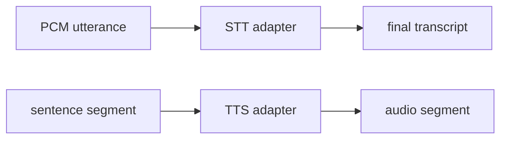

Provider requirements:

- caller context carries deadline and cancellation;
- provider-specific status is mapped to stable voice error codes;
- all output is size/duration bounded;
- no provider receives more context/audio than needed;
- audio format conversion is explicit and observable;
- model, STT, and TTS credentials are server-side only.

Select actual providers only after comparing one local and one hosted option against the same utterance set. The first release may use a provider that returns complete WAV/MP3 segments; streaming TTS is a later optimization.

The contracts deliberately permit later edge providers. A compatible satellite may advertise local STT or local TTS capability, but `voice-gateway` chooses that route only when the device policy and negotiated capability allow it. Local TTS is the more plausible first edge optimization for offline acknowledgement; local STT is deferred until privacy, WAN independence, or measured latency justifies its CPU, memory, model-distribution, and support cost. Neither changes the satellite protocol or the provider interfaces.

### 8.4 Configuration and Credential Ownership

Service-wide voice settings remain deployment configuration, following existing `.env`, Compose, Helm Values, ConfigMap, and Kubernetes Secret conventions:

| Category | Examples | Storage |
|---|---|---|
| Non-secret runtime configuration | provider base URLs, default Open WebUI model, audio profile, timeouts, feature flags, pairing timeout | `.env` / Helm Values / ConfigMap |
| Provider credentials | STT/TTS API credentials and optional server-to-server provider secrets | Kubernetes Secret or existing runtime secret injection |
| Satellite credential | device-specific pairing result | satellite local protected storage plus server-side credential record |
| MCP OAuth connection | Open WebUI client registration, consent grant, access/refresh tokens | Open WebUI's connection store and HomeNavi auth-service; never ConfigMap |
| User room/name placement | inventory metadata | ERS/map workflow |

Do not make a voice-specific settings database for deployment parameters. Use the established deployment configuration path. Do not place user consent, OAuth tokens, refresh tokens, pairing secrets, or per-device credentials in ConfigMaps.

## 9. HomeNavi Tool and Context Policy

Voice must reuse HomeNavi policy. The LLM runtime, initially Open WebUI, is the MCP client and tool executor. It selects from its configured HomeNavi MCP endpoints and invokes tools directly. `voice-gateway` does not interpret, proxy, or invoke model tool calls or device commands.

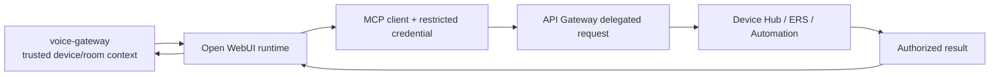

Context hierarchy:

1. HDP device identity identifies the satellite and its capability set.
2. Gateway resolves the satellite room from ERS.
3. Gateway provides the trusted origin room as conversational context and records it against the turn.
4. Model resolves an explicit target or uses the origin room only for relative language such as "here".
5. MCP validates the OAuth access token, consented scopes, client grant, and tool policy before its delegated call.
6. Target domain service makes the final authorization decision.

For v1, support read-only room queries and idempotent desired-state commands first. Avoid `toggle` semantics. Require confirmation for sensitive actions such as locks, alarms, access control, purchases, or destructive automations.

## 10. Satellites as HomeNavi Devices

Each paired Orion satellite is a first-class HomeNavi device. The satellite runtime remains a separate edge release, but the Orion HDP adapter publishes normalized metadata/state after central pairing completes. Device Hub exposes the discovered device and ERS creates or binds the canonical inventory record through normal reconciliation. The user assigns room placement later from the map view. Pending pairing candidates are not devices and are intentionally absent from Device Hub, HDP, ERS, dashboards, and automations.

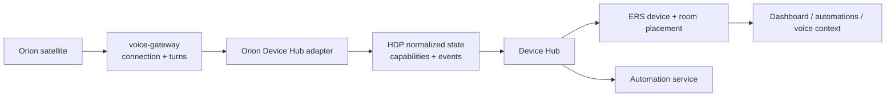

Initial device metadata:

- device type: `voice_satellite`;
- hardware model, firmware/runtime version, audio hardware identifier, and connectivity state;
- ERS room placement and tags;
- health: online, audio-ready, microphone-muted, last-seen, fault code;
- feature flags: wake word, VAD, playback, local mute, barge-in, LED/display;
- current activity: idle, listening, thinking, speaking, offline, or fault.

Initial capabilities:

| Capability | State | Commands | Event use |
|---|---|---|---|
| `audio_input` | muted, ready, level | mute, unmute | privacy/health |
| `audio_output` | volume, playing | set volume, stop playback | media interruption |
| `voice_assistant` | activity, active turn summary | cancel turn, disable voice | dashboard/automation |
| `wake_word` | enabled, sensitivity | enable, disable, configure sensitivity | household policy |
| `indicator` | status, brightness | set status, set brightness | local feedback |

Commands sent through Device Hub are desired-state requests. The gateway maps supported commands to its active satellite session, returns an explicit offline/not-supported result when needed, and publishes resulting state through HDP. Automated mute, disable, and stop-playback actions are therefore available to the rest of HomeNavi without giving automations access to raw audio or model credentials.

## 11. Edge Runtime Design

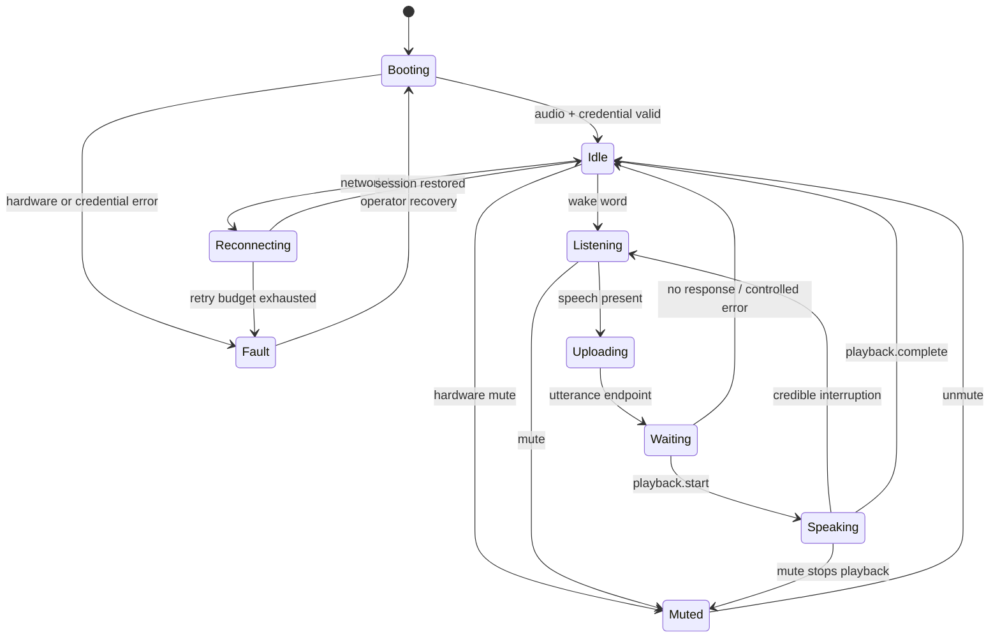

Satellite requirements:

- resolve audio hardware by stable device identity rather than ALSA index;
- confirm input channel map and output route at startup;
- run local wake-word detection while idle;
- use VAD and local endpointing only after activation;
- retain a bounded rolling input buffer only for active turns;
- immediately stop local output and clear stale chunks on cancel;
- reject output whose `turn_id` or `playback_id` is no longer active;
- provide status LEDs/UI for muted, listening, thinking, speaking, offline, and fault;
- reconnect without replaying old audio or old turns.

### 11.1 Barge-In Rollout

Do not enable full barge-in in the first end-to-end demo. Enable it only after the ReSpeaker processed channel, AEC reference, speaker route, and VAD persistence threshold have hardware evidence.

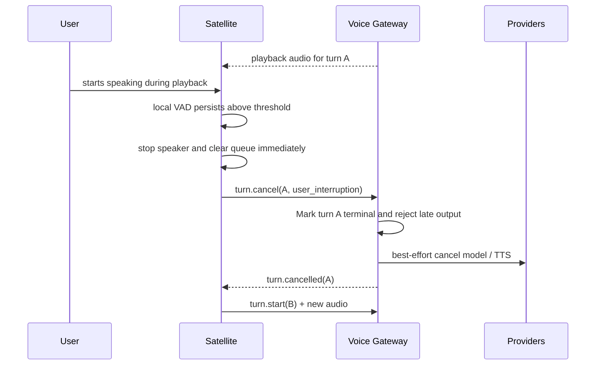

## 12. Persistence, Recovery, and Retention

### 12.1 PostgreSQL Tables

Add a dedicated schema or service-owned tables. Initial records:

| Table | Purpose |
|---|---|
| `voice_device_credentials` | HDP device reference, credential metadata, enabled state |
| `hdp_pairing_lifecycles` | Device Hub-owned central pairing session and progress lifecycle |
| `voice_conversations` | device/room policy mapping to model conversation identity |
| `voice_turns` | audit-safe lifecycle metadata, terminal status, timings, error code |
| `voice_tool_audit` | turn/origin device and room, tool name, authorization result, outcome |

Do not store raw audio by default. Store transcript text only if the explicit product policy permits it; otherwise retain a hash, length, language, and status for diagnostics. Put short-lived active turn/session state in Redis with an expiry.

### 11.2 Recovery Rules

- gateway restart: terminalize or expire active turns; satellites reconnect and create new turns;
- satellite disconnect: cancel active turn after a short grace period and discard unsent playback;
- provider timeout: return stable error, release permits, keep gateway ready for other satellites;
- late provider output: drop if turn is not active;
- duplicate cancel: acknowledge idempotently;
- device revocation: reject new sessions and cancel active turns for that device.

## 13. Observability

Follow HomeNavi's existing OpenTelemetry, Prometheus, and structured logging patterns.

`voice-gateway` and a separate `orion-adapter`, if introduced, must use `shared/observability.SetupObservability(serviceName)` at startup and `shared/observability.MetricsAndTracingMiddleware` for HTTP routing, with the shared Prometheus handler and global `OTEL_EXPORTER_OTLP_TRACES_ENDPOINT` injection used by other core services. Do not add a second tracing convention or a voice-only exporter. Add child spans around STT, TTS, Open WebUI HTTP calls, pairing work, Redis/database activity, and background reconnect/retry loops. MQTT/HDP pairing and command flows must carry the existing correlation IDs and attach them to logs/spans where trace-context propagation is unavailable.

The existing difficulty seeing complete traces is a platform observability gap, not a reason to omit the standard instrumentation. The POC exit gate includes verifying that a gateway request creates an exported trace and that its outbound provider spans are visible before relying on tracing for diagnosis.

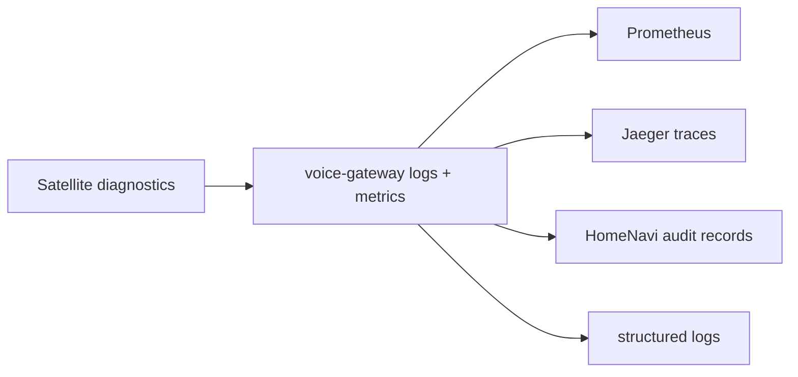

Required metrics:

- active satellites, sessions, turns, and provider concurrency;
- turn outcomes by stable error code;
- wake-to-session, utterance-end-to-transcript, first-token, first-audio, and total-turn latency histograms;
- cancellation-to-local-stop reported by satellite and cancellation acknowledgement latency;
- STT/model/TTS timeout and failure counters;
- audio frame drops, input overruns, output underruns, and queue duration;
- satellite reconnects, authentication failures, and protocol rejections.

Trace one turn end to end. Use `turn_id` and `request_id` in logs, but do not use them as Prometheus labels.

## 14. Deployment Profiles

| Profile | Core | Provider location | Satellite | Intended use |
|---|---|---|---|---|
| `core` | no voice workloads | none | none | ordinary HomeNavi |
| `voice-dev` | voice gateway + fakes | local mocks | simulator | CI/local development |
| `voice-lan` | voice gateway | Open WebUI + selected STT/TTS | one Pi | first prototype |
| `voice-homelab` | gateway with resource limits | configurable local/hosted adapters | multiple Pis | beta |

Add `voice-gateway` as an opt-in Helm and Compose profile. It must not block core application readiness. Put gateway routing behind Nginx/API Gateway at a dedicated voice endpoint, and expose provider health separately from gateway liveness.

### 14.1 Cluster-First POC Profile

The POC runs all server-side components in the existing cluster. It uses the already configured Open WebUI `orion` model, which already connects to HomeNavi MCP, plus one selected in-cluster STT provider and one selected in-cluster TTS provider. The Pi runs only the reference satellite agent and connects outbound to the gateway.

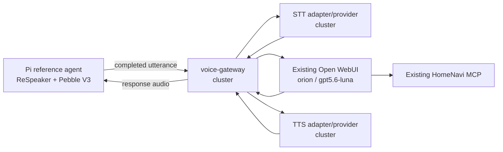

The POC excludes multi-room behavior, barge-in, hosted providers, third-party satellite implementations, and a polished device-management UI. It uses the existing Devices-tab pairing flow through the Orion HDP adapter, then leaves room placement to the existing map workflow. It keeps the production protocol identifiers (`pairing_id`, `device_id`, `room_id`, `session_id`, and `turn_id`) from the first implementation.

### 14.2 Managed Satellite and Unmanaged Client Modes

| Mode | Connection path | HomeNavi registration | Best fit | Tradeoff |
|---|---|---|---|---|
| Managed satellite | satellite -> voice-gateway -> Open WebUI | central Devices pairing, HDP, ERS | fixed room hardware and automation/notification playback | requires gateway and adapter operation |
| Unmanaged conversational client | client -> Open WebUI directly | none | smartphones, browser clients, and third-party AI integrations | no HDP state, map identity, automation playback, or device health |

Unmanaged mode is a supported simpler alternative. A phone or third-party client may capture audio, use Open WebUI's STT/TTS capability, and receive feedback directly without `voice-gateway` or any device registration. It may still connect Open WebUI or another client to HomeNavi MCP through normal OAuth consent. This is the intended starting point for mobile use and future native-app/Siri-style integrations. It intentionally cannot be addressed by HomeNavi automations for room notifications because HomeNavi has no paired satellite/session through which to play them.

## 15. Implementation Roadmap

### Phase 0: Existing Baseline and POC Boundary

Deliverables:

- `doc/orion/architecture.md`, `protocol.md`, and ADRs based on this roadmap;
- exact Pi, OS, CPU architecture, ReSpeaker firmware/channel map, and speaker routing record;
- record the existing Open WebUI `orion` model, `gpt5.6-luna`, and HomeNavi MCP connection as the POC model baseline;
- reproduce one read-only and one idempotent HomeNavi MCP action from the existing Orion model;
- complete the normal Open WebUI-to-HomeNavi OAuth authorization and consent flow with the scopes needed for that action;
- select in-cluster initial STT/TTS candidates and record their CPU/GPU, image, language, voice, and health requirements.

Exit gate:

- a short local recording can be captured and played;
- processed ReSpeaker channel and playback route are documented;
- the existing Orion model can perform the MCP flow manually;
- an OAuth grant is visible and revocable in HomeNavi Connected Applications;
- no architecture assumption remains unverified where it affects protocol design.

### Phase 1: Satellite Audio Diagnostics

Implement in `homenavi-orion-satellite`:

- `orion-audio-diagnostics` command;
- stable device discovery and configuration override;
- capture/playback test, channel inspector, levels, buffer counters;
- ReSpeaker/Pebble AEC test procedure.

Exit gate:

- normal speaker volume does not cause routine self-triggering on the processed mic channel;
- device removal/replug has a clear recoverable error;
- diagnostics do not store raw audio unless explicitly enabled.

### Phase 2: Cluster POC Protocol and Gateway Skeleton

Implement in this repository:

- `voice-gateway` WebSocket endpoint;
- Orion HDP adapter hello/status, pairing configuration, and central Devices-tab pairing command/progress flow;
- protocol schemas and satellite simulator;
- session/turn state machine with fake STT/model/TTS adapters;
- health, readiness, metrics, tracing, and structured safe errors.

Exit gate:

- unregistered satellite cannot open a session;
- spoofed device/room fields cannot change resolved identity;
- malformed and oversized frames are rejected;
- simulator proves independent turns for two devices.
- a gateway request and outbound provider calls export visible OTEL spans in the configured trace backend.

### Phase 3: One Complete Cluster Audio Turn

Implement:

- local wake-word/VAD stub or manual push-to-talk activation;
- capture final utterance and send bounded PCM frames;
- selected in-cluster STT adapter;
- selected in-cluster TTS adapter and real playback loop.

Exit gate:

- one satellite performs capture -> transcript -> spoken response repeatedly;
- idle audio is not transmitted;
- STT failure leaves the satellite in a valid idle state;
- all active queues are bounded.

### Phase 4: Existing Orion and MCP Integration

Implement:

- Open WebUI `orion` streaming parser;
- conversation mapping policy;
- speakable-text segmenter;
- tool-event filtering;
- runtime request/response audit records; Open WebUI remains the MCP tool executor.

Exit gate:

- a voice request can perform a permitted read-only MCP operation;
- permitted idempotent command executes once;
- tool-call JSON and internal events are never spoken;
- denied/tool failure response is safe and intelligible.

### Phase 5: HDP Discovery, ERS Reconciliation, and Playback Reliability

Implement:

- selected TTS adapter;
- sentence segment queue, sequence handling, playback acknowledgement;
- audio output format conversion and limits;
- Orion adapter pairing lifecycle, retained HDP metadata/state, Device Hub discovery, and ERS binding;
- manual room placement from the existing map workflow.

Exit gate:

- first sentence can play before a long answer finishes;
- chunks route only to the originating device;
- duplicate, stale, wrong-turn, and out-of-order chunks are handled safely;
- output failure does not leave a stuck speaking state;
- an unpaired candidate is absent from HDP, ERS, dashboards, and automations.

### Phase 6: Cancellation and Barge-In

Implement:

- immediate local playback stop;
- scoped `turn.cancel` and provider cancellation;
- stale-output rejection;
- AEC/VAD persistence tuning and half-duplex fallback.

Exit gate:

- cancelling room A never affects room B;
- no late audio is audible after a cancellation;
- cancellation does not repeat or reverse completed side effects;
- false-interruption rate is acceptable on the defined hardware test set.

### Phase 7: BYOD and Multi-Room Beta

Implement:

- device management UI and revocation flow;
- explicit room policy configuration;
- provider concurrency limits and overload behavior;
- dashboards/runbooks for satellite and provider health;
- backup/update/recovery procedures;
- reference-agent setup, compatibility, and conformance-test documentation for BYOD adopters.
- unmanaged Open WebUI/mobile/third-party client guidance and capability limitations.

Exit gate:

- two hardware satellites sustain concurrent turns;
- gateway/provider restart recovery is safe;
- operational telemetry identifies the source of every failed turn;
- multi-day soak test completes without an unrecovered stuck session.

## 16. Test Plan and Quality Gates

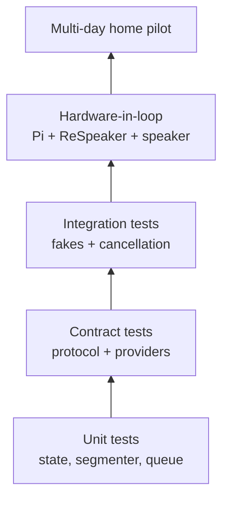

### Required Unit Tests

- valid/invalid turn state transitions;
- cancellation idempotency and terminal-state immutability;
- per-device isolation of queues and cancellation tokens;
- text segmentation for punctuation, decimals, markdown, tool-only responses, and long buffers;
- playback sequence ordering, deduplication, stale IDs, and bounded queue behavior;
- safe provider error mapping;
- credential and room identity validation.

### Required Integration Tests

- fake satellite performs full turn;
- fake STT empty/corrupt/timeout behavior;
- Open WebUI stream fixtures for text, tool call, tool result, usage, malformed event, and cancellation;
- authorized, denied, timeout, and idempotent tool behavior;
- TTS output after cancellation is discarded;
- satellite disconnect during every turn phase;
- two concurrent satellite turns with one cancellation;
- gateway restart does not replay stale audio.

### Hardware Test Matrix

| Scenario | Evidence |
|---|---|
| quiet-room wake word | activation and false-positive count |
| normal speech at distance | STT quality and timing |
| speaker playback with mic open | AEC/VAD leakage behavior |
| user speaks over response | local stop latency and false interruption rate |
| Wi-Fi loss | reconnect without replay |
| ReSpeaker unplug/replug | recovery or actionable fault |
| long answer | playback buffer duration and memory |
| two rooms | no cross-routing/cancellation |

## 17. Initial Backlog by Repository

### `homenavi`

1. Create `voice-gateway` service scaffold using existing Go conventions.
2. Add protocol schemas and a simulator test package.
3. Add database migration for voice credentials/turn audit; use Device Hub pairing lifecycle storage rather than a voice-specific pairing table.
4. Add `voice-dev` fake-provider profile to Compose and Helm.
5. Implement the Orion HDP adapter pairing contract, retained metadata/state, and device-principal middleware.
6. Implement session and turn manager with Redis expiry.
7. Implement first STT, Open WebUI, and TTS adapters behind interfaces.
8. Add voice gateway metrics, traces, and dashboards/runbooks.
9. Add Orion pairing configuration to the existing Devices flow; use the existing map workflow for room assignment; add mute/disable and health where appropriate.

### `homenavi-orion-satellite`

1. Create Linux service scaffold and reproducible packaging.
2. Implement audio diagnostics before wake-word work.
3. Implement connection/configuration/device credential client.
4. Implement push-to-talk/manual turn test client.
5. Add wake-word and VAD after recording baseline audio behavior.
6. Add playback queue and turn/playback ID validation.
7. Add cancellation/local-stop behavior.
8. Add status LED/UI and non-sensitive diagnostics bundle.

## 18. ADRs Required Before Phase 2

1. **ADR-001: Satellite transport** - TLS WebSocket prototype, binary framing, migration criteria for WebRTC.
2. **ADR-002: Device credentials** - central pairing inputs, credential type, rotation, revocation, and storage.
3. **ADR-003: Voice authorization principal** - household/device scopes and confirmation rules.
4. **ADR-004: Turn persistence** - PostgreSQL/Redis ownership, TTLs, restart behavior, and transcript retention.
5. **ADR-005: Open WebUI adapter contract** - supported endpoint, stream semantics, cancellation behavior, and fixture source.
6. **ADR-006: STT/TTS selection** - local versus hosted provider evaluation criteria.
7. **ADR-007: Barge-in rollout** - required hardware metrics and half-duplex fallback policy.
8. **ADR-008: Orion adapter topology** - co-locate in voice-gateway or deploy a dedicated HDP adapter without changing the pairing contract.
9. **ADR-009: Open WebUI MCP OAuth** - client registration, redirect URI, requested scopes, connection-owner user, and revocation experience.

## 19. Definition of Done for a Limited Pilot

The limited pilot is ready only when:

- one complete audio-to-tool-to-audio path works repeatedly on real hardware;
- idle audio does not leave the satellite;
- authorization is enforced by HomeNavi services, not model prompting;
- cancellation is scoped and late audio is rejected;
- two satellite sessions prove isolation;
- raw audio, credentials, and provider payloads do not appear in normal logs;
- all provider failures map to safe user-facing messages and diagnosable internal codes;
- central pairing, disable, revocation, restart, upgrade, and recovery procedures are documented and tested;
- latency and reliability are measured on the actual Pi/provider/network combination rather than assumed.

## 20. Immediate Next Action

Start Phase 0 and Phase 1 in parallel: inventory the actual Raspberry Pi and ReSpeaker behavior while creating the protocol/ADR skeleton. Do not implement a general voice UI, streaming TTS, or full barge-in until a manual push-to-talk vertical slice proves the end-to-end turn lifecycle with Open WebUI and existing HomeNavi MCP controls.